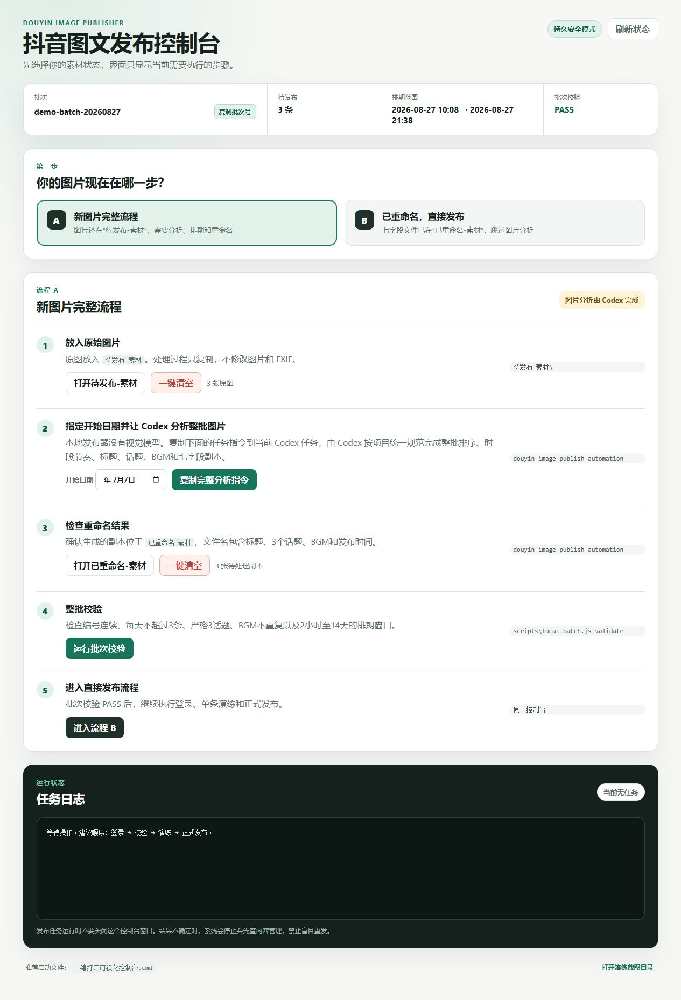
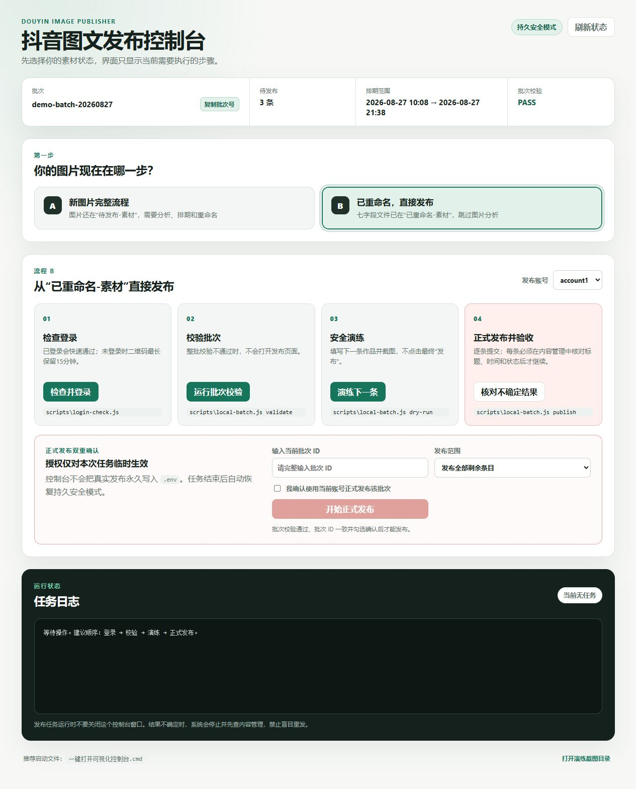

# Douyin Image Publisher

English | [简体中文](README.zh-CN.md)

A local-first Playwright RPA console for preparing, validating, dry-running, and publishing scheduled Douyin image posts.



The project combines a Windows control panel, a strict filename-based batch format, optional Feishu Base integration, and explicit production authorization. It is designed for accounts and content that you own or are authorized to operate.

> This is an independent community project. It is not affiliated with, endorsed by, or sponsored by Douyin, ByteDance, Feishu, or Lark. Browser automation can break when third-party pages change; always follow platform rules and keep human review in the loop.

## Why this project

Image-post operations often fail at the boundaries: duplicated schedules, mismatched titles, repeated music, stale login sessions, uncertain publish results, or a retry that accidentally creates a duplicate post. This project puts deterministic checks around those boundaries before it allows a real publish.

## Core capabilities

- Visual local control panel with two guided workflows: prepare a new image batch or publish an already renamed seven-field batch.
- Separate browser profiles for multiple authorized Douyin accounts.
- Strict one-image-per-post filename contract with title, three topics, BGM, singer, and schedule.
- Batch checks for numbering, title length, unique schedules, three posts per day, topic combinations, and BGM variants.
- Long QR-login window, upload preview verification, page preflight, and safe dry-run screenshots.
- Real publishing gated by both dry-run configuration and an exact batch authorization ID.
- Post-submit verification in Content Management before the local ledger is updated.
- Read-only reconciliation for uncertain results; the workflow never retries a possibly submitted post blindly.
- Optional Feishu Base polling and status write-back.

## Screenshots

| Full preparation flow | Direct publish flow |
|---|---|
|  |  |

The screenshots use synthetic demo data. They contain no account profile, cookie, QR code, real user media, or production batch.

## Safety model

```text
Local images → content-plan validation → strict batch validation
→ browser dry run → exact batch ID + explicit confirmation
→ publish → Content Management verification → verified local ledger
```

Important boundaries:

- The visual control panel listens only on `127.0.0.1`.
- The optional HTTP bridge also defaults to loopback. A non-loopback `HOST` requires a non-placeholder `BRIDGE_SECRET` of at least 16 characters.
- Persistent `DOUYIN_DRY_RUN=true` is the safe default.
- A real publish also requires an exact `DOUYIN_AUTHORIZED_BATCH_ID`; the control panel injects it only into the confirmed child task.
- Browser profiles, `.env`, `config.json`, workspace content, local ledgers, downloaded media, and operational screenshots are ignored by Git.
- Local uploads are restricted to configured workspace/download roots. Feishu image downloads require public HTTPS destinations, permit at most three redirects, verify PNG/JPEG/WebP signatures, and stop at 20 MiB.
- The two folder-clear buttons permanently delete only the contents of their fixed workspace directories. They require explicit confirmation and are blocked while a task is running.

## Requirements

- Windows 10 or 11 for the guided launcher and visible browser workflow.
- Node.js 20 or newer.
- Google Chrome when `DOUYIN_BROWSER_CHANNEL=chrome` (the default).
- Authorized access to Douyin Creator Center.
- Optional: a Feishu/Lark internal app with Base record read/write permissions.

Browser RPA should run in a logged-in desktop session. Headless and unattended server operation is less reliable and may conflict with platform requirements.

## Quick start

```powershell
git clone git@github.com:wyg916/douyin-fabu.git
cd douyin-fabu
npm.cmd ci
Copy-Item .env.example .env
Copy-Item config.example.json config.json
New-Item -ItemType Directory -Force workspace\待发布-素材, workspace\已重命名-素材
Copy-Item 发布配置.example.json workspace\发布配置.json
npm.cmd run panel
```

Edit `workspace\发布配置.json` with a valid start date and a new unique batch ID, then open <http://127.0.0.1:3400/>. You can also double-click `一键打开可视化控制台.cmd`.

Run the verified project checks:

```powershell
npm.cmd run check
```

## Workspace and batch format

The default local workspace is ignored by Git:

```text
workspace/
├─ 待发布-素材/
├─ 已重命名-素材/
└─ 发布配置.json
```

Each prepared image uses exactly seven hyphen-separated fields:

```text
图片NN-第NN条发布内容-标题-#话题1 #话题2 #话题3-BGM歌名-歌手-YYYY年MM月DD日HH时mm分.jpg
```

The batch validator rejects malformed or non-contiguous numbering, multiple images per post, titles longer than 15 characters, anything other than exactly three topics, duplicated schedules, more than three posts per day, repeated BGM variants, and schedules outside the two-hour-to-fourteen-day window.

Validate without opening a browser:

```powershell
npm.cmd run validate:local
```

## Workflow A: prepare a new batch

1. Put original images in `workspace\待发布-素材`.
2. Select a start date in the control panel.
3. Copy the generated instruction into a Codex task with the optional `douyin-image-publish-automation` skill.
4. Validate the generated content plan:

```powershell
npm.cmd run validate:content-plan -- "<path-to-plan.json>" --start-date YYYY-MM-DD
```

5. Keep originals unchanged and place renamed copies in `workspace\已重命名-素材`.
6. Run the full local batch validation.

The local publisher does not contain an image-understanding model. Image analysis is an optional, separate preparation step; validation and publishing operate from prepared filenames until the browser is opened.

## Workflow B: dry run and publish

```powershell
npm.cmd run login:account1
npm.cmd run dry-run:local -- --account account1 --limit 1
npm.cmd run dry-run:local -- --account account1 --all
```

For a real publish, both values must match the current reviewed batch:

```env
DOUYIN_DRY_RUN=false
DOUYIN_AUTHORIZED_BATCH_ID=<current-batch-id>
```

Then run:

```powershell
npm.cmd run publish:local -- --account account1 --all
```

The visual control panel is safer for routine use because its authorization is temporary and task-scoped. If a submit result is uncertain, run the read-only reconciliation command before any new attempt:

```powershell
npm.cmd run reconcile:local -- --account account1
```

## Configuration

Copy `.env.example` to `.env`. Empty path variables use safe local defaults.

| Variable | Required | Default | Purpose | Sensitive |
|---|---:|---|---|---:|
| `HOST` | No | `127.0.0.1` | Optional HTTP bridge bind address | No |
| `PORT` | No | `3300` | HTTP bridge port | No |
| `BRIDGE_SECRET` | For non-loopback | empty | Authenticates bridge requests | Yes |
| `DOUYIN_HEADLESS` | No | `false` | Run browser without a visible window | No |
| `DOUYIN_DRY_RUN` | No | `true` | Persistent real-publish gate | No |
| `DOUYIN_BROWSER_CHANNEL` | No | `chrome` | Playwright browser channel | No |
| `DOUYIN_WORKSPACE_DIR` | No | `./workspace` | Local batch workspace | May reveal a path |
| `DOUYIN_LOCAL_IMAGE_DIR` | No | workspace subfolder | Prepared image directory | May reveal a path |
| `DOUYIN_BATCH_CONFIG` | No | workspace JSON | Batch configuration path | May reveal a path |
| `DOUYIN_AUTHORIZED_BATCH_ID` | For real publish | empty | Exact reviewed batch authorization | Operational data |
| `LARK_APP_ID` | For Feishu | empty | Feishu/Lark app ID | Yes |
| `LARK_APP_SECRET` | For Feishu | empty | Feishu/Lark app secret | Yes |
| `FEISHU_BASE_TOKEN` | For Feishu | empty | Default Base token | Yes |

To expose the optional bridge beyond loopback, generate a local secret and keep it out of Git:

```powershell
node -e "console.log(require('crypto').randomBytes(32).toString('hex'))"
```

## Optional Feishu Base integration

The scheduler processes only reviewed rows inside the valid scheduling window. Real scheduler publishing additionally requires the row batch ID to match `DOUYIN_AUTHORIZED_BATCH_ID`.

Rows that cannot be published are evaluated before browser automation and skipped one by one: the round never aborts, and each row is written back with `发布状态=跳过` and a `发布失败原因` that distinguishes a persistent dry run (`DOUYIN_DRY_RUN=true`, no Feishu write-back at all) from a batch-ID mismatch (both the record batch ID and the authorized batch ID are included). Other rows in the same round still run. At the end of every round the scheduler prints, per row, the table, record ID, outcome (`已发布`/`干跑完成`/`跳过`/`失败`) and reason.

```powershell
npm.cmd run scheduler:once
npm.cmd run scheduler
npm.cmd start
npm.cmd run health
```

The HTTP bridge is an integration surface, not a replacement for the local control panel. Do not expose it to the Internet without an authenticated reverse proxy, network filtering, TLS, and an independent threat review.

## Docker

The image runs the optional HTTP bridge rather than the Windows control panel. It binds to `0.0.0.0` inside the container and refuses to start without a strong `BRIDGE_SECRET`.

```bash
docker build -t douyin-fabu .
docker run --rm -p 127.0.0.1:3300:3300 \
  -e BRIDGE_SECRET=replace-with-a-local-secret \
  douyin-fabu
```

Never bake `.env`, browser profiles, or real media into an image.

## Project structure

```text
control-panel.js              loopback-only visual control panel
public/                       control panel UI
publish-policy.js             strict batch and authorization policy
local-batch.js                batch, ledger, and attempt state
douyin.js                     Playwright automation and verification
feishu.js                     optional Feishu/Lark integration
scripts/                      CLI entry points
test/                         Node test suite
docs/image-content-planning.md optional content-planning contract
```

## Known limitations

- Douyin UI selectors and wording can change without notice.
- QR login, content checks, music search, and moderation remain platform-controlled.
- The control panel is Windows-oriented and opens folders with Explorer.
- Permanent folder clearing cannot be undone by this project.
- This project can verify only observable Creator Center state, not guarantee platform acceptance.

## Contributing and security

Read [CONTRIBUTING.md](CONTRIBUTING.md), [SECURITY.md](SECURITY.md), [SUPPORT.md](SUPPORT.md), and the [Code of Conduct](CODE_OF_CONDUCT.md). Never attach real profiles, cookies, QR codes, tokens, user images, or unredacted operational screenshots to an issue.

## Acknowledgements

This repository began from [FKZn10/douyin-rpa-publisher](https://github.com/FKZn10/douyin-rpa-publisher), distributed under the MIT License. The current project keeps that Git history and adds the strict local batch workflow, visual control panel, publishing gates, reconciliation, tests, and open-source hardening.

## License

[MIT](LICENSE)
