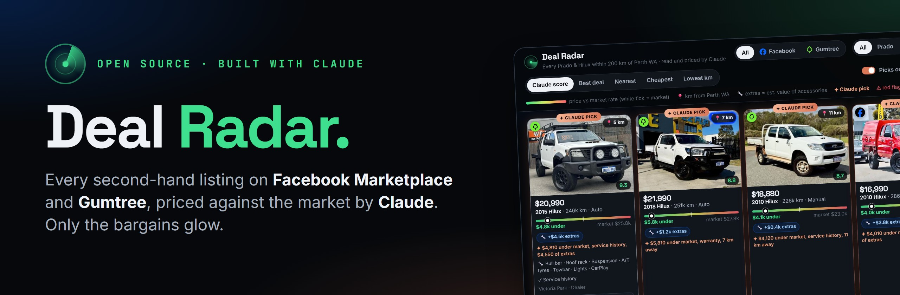
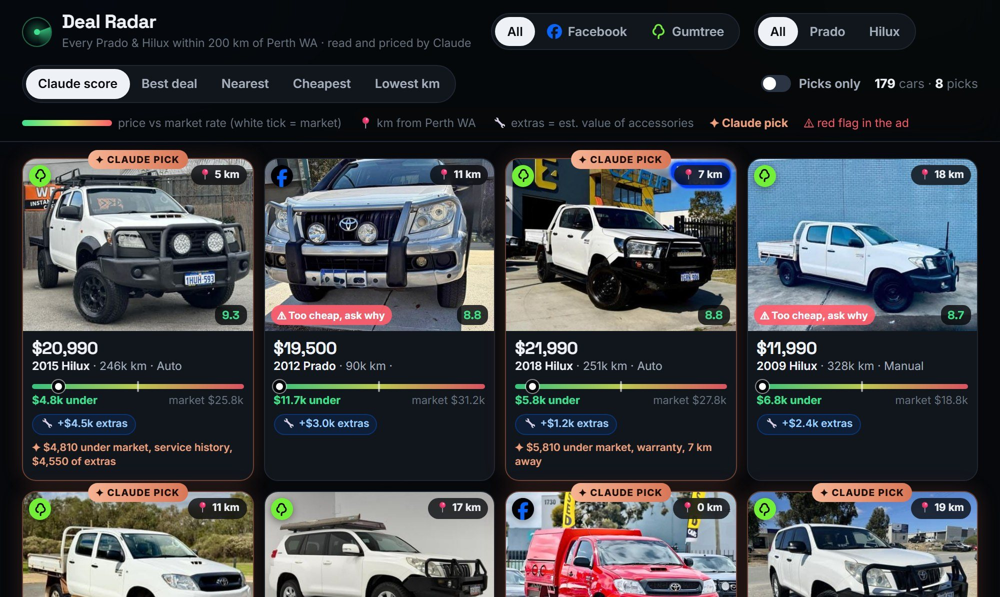
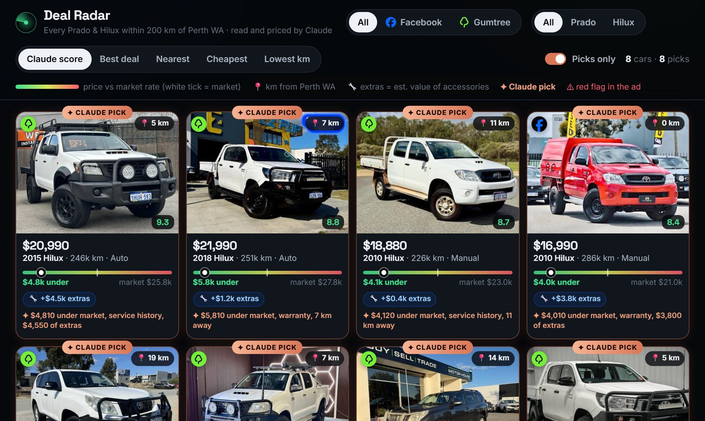
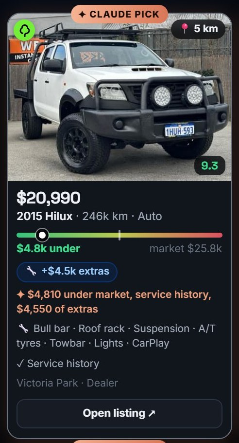
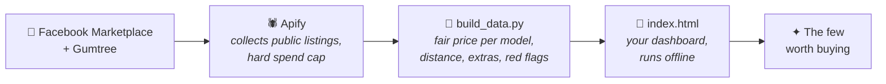

<p align="center">
  
</p>

<h3 align="center">Never overpay second-hand again.</h3>

<p align="center">
  Deal Radar pulls every listing for what you're buying from <b>Facebook Marketplace</b> and <b>Gumtree</b>,<br>
  works out what each one <i>should</i> cost, reads the fine print, and shows you the few worth buying.
</p>

<p align="center">
  <a href="https://deal-radar-demo.vercel.app"></a>
  <a href="https://deal.myceliumai.com.au"></a>
  
  
  
  
</p>

<p align="center">
  <a href="https://deal-radar-demo.vercel.app"><b>See the live demo</b></a> ·
  <a href="#-never-written-code-start-here"><b>No-code setup</b></a> ·
  <a href="#-quick-start"><b>Quick start</b></a> ·
  <a href="https://youtube.com/@aaron-parton"><b>YouTube</b></a>
</p>

---

## 📡 What it does

I was after a second-hand ute, so I pointed this at every Prado and Hilux within 200 km of Perth.
**179 listings came back. Claude said 8 were worth buying.**

<p align="center">
  
</p>

Every card answers the questions you'd otherwise spend a weekend on:

| | |
|---|---|
| 💰 **Is it a fair price?** | A green-to-red bar shows where the price sits against what that year and km *should* cost, worked out from every other listing like it. |
| 📍 **Is it worth the drive?** | Kilometres from your house, on every card. |
| 🔧 **What are the extras worth?** | Bull bar, canopy, lights, roof rack: added up, so you compare a bare one with a kitted-out one like for like. |
| ⚠️ **What's the catch?** | Written off, needs work, ex-mine, too cheap to be true: flagged from the fine print before you drive out. |
| ✦ **Which ones should I message?** | Claude's picks glow orange: the best value with the least risk. Flick **Picks only** and the wall drops to just those. |

<table>
  <tr>
    <td width="62%"></td>
    <td width="38%"></td>
  </tr>
  <tr>
    <td align="center"><sub><b>Picks only</b>: the wall drops to the ones worth a test drive</sub></td>
    <td align="center"><sub><b>Click a card</b>: accessories, good signs, red flags, the listing</sub></td>
  </tr>
</table>

**Works for anything second-hand.** A boat, a mountain bike, camera gear, your next couch. Tell Claude what you're
after and it adapts the pricing, the add-ons and the red flags.

## ⚙️ How it works



1. **`fetch_listings.py`** pulls every listing for your search through two Apify scrapers. It works out the
   worst-case cost first, asks before spending, and starts every run with a spend cap Apify itself enforces.
2. **`build_data.py`** fits a fair price for each model *from your own search results* (price against year and km),
   then scores every listing: value against the market, extras, good signs, red flags and distance.
3. **`index.html`** is the dashboard. Double-click it. No server, no account, nothing uploaded anywhere.

## 🧑‍💻 Never written code? Start here

You don't need any coding apps. The Claude app does all of it for you.

1. Install the **[Claude app](https://claude.com/download)** (Pro plan or higher). On Windows, also install
   **[Git for Windows](https://git-scm.com/downloads/win)** (click Next on every screen).
2. On this page click the green **Code** button → **Download ZIP**, then extract it somewhere easy like Documents.
3. In the Claude app click **Code** → **Local** → **Select folder**, pick the `deal-radar-main` folder and say:

> Read CLAUDE.md. I've never coded before. Check whether Python is installed and install it for me if it isn't.
> Then help me set up Deal Radar for what I'm buying.

Claude asks what you're after, sets everything up, shows you the cost before anything is spent, and builds your
dashboard. **[Get the free step-by-step guide](https://deal.myceliumai.com.au)** with screenshots of every step.

## ⚡ Quick start

```bash
pip install -r requirements.txt
cp .env.example .env          # then paste your Apify token into .env
# edit config.json, or ask Claude: "set this up for a 2016-2021 Ranger under $35k, I live in Geelong"
python fetch_listings.py      # prints the worst-case cost and asks before spending
python build_data.py          # fair prices, extras, red flags, picks -> data.js
# open index.html
```

Your search lives in **`config.json`**:

```jsonc
{
  "home": { "name": "Perth WA", "lat": -31.9523, "lng": 115.8613 },   // distance is measured from here
  "radius_km": 200,
  "price_min": 8000, "price_max": 40000,
  "models": [
    { "name": "Prado", "match": "prado", "min_year": 2009, "max_year": 2017 },
    { "name": "Hilux", "match": "hilux", "min_year": 2005, "max_year": 2022 }
  ],
  "exclude": "\\b4x2\\b|\\b2wd\\b|wanted|parts only",               // deal-breakers
  "facebook": { "city_slug": "perth", "queries": ["toyota prado", "toyota hilux"], "results_per_query": 150 },
  "gumtree":  { "enabled": true, "location_id": "3008303", "keywords": ["toyota prado", "toyota hilux"], "max_items": 200 },
  "budget_usd": 4.0                                                     // the run refuses to start above this
}
```

## 💸 What it costs

| | Cost |
|---|---|
| Apify account | **Free**, with US$5 of usage included every month |
| A Facebook Marketplace listing | ~US$0.006 |
| A Gumtree listing | ~US$0.002 |
| **A typical search** (300 Facebook + 200 Gumtree) | **~US$2.20**, inside the free credit |
| Claude | A Pro plan or higher, for the Claude app's Code tab |

## 🔒 Safe by design

- **Your Facebook login is never used.** The Marketplace scraper reads public listings. If anything ever asks for
  your Facebook password or cookies, say no.
- **Spending is capped twice:** a cost check before every run, plus a hard `maxTotalChargeUsd` cap on the Apify run
  itself. Set a monthly limit in your Apify billing settings as well.
- **Your token stays on your computer**, in `.env`, which git ignores. Nothing in this repo phones home.
- **Your data stays local.** Listings, photos and your dashboard live in this folder, and are git-ignored too.

## 📁 What's in here

| File | What it does |
|---|---|
| `config.json` | Your hunt: models, years, budget, suburb, radius, search words, spend limit |
| `fetch_listings.py` | Pulls listings via Apify, with a cost check and a hard spend cap |
| `build_data.py` | Fair prices, distance, accessories, red flags, scores, picks → `data.js` + `thumbs/` |
| `index.html` | The dashboard. Double-click to open |
| `CLAUDE.md` | Instructions that tell Claude how to set up and run all of this for you, safely |

## 🙋 Good to know

- **Asking prices, not sale prices.** "Fair price" is what similar listings are *asking* right now. It's a strong
  guide, not a valuation, and only as good as the listings in your search. Most private sellers will move a bit.
- **Buying a car in Australia?** Run a **PPSR check** ($2 at [ppsr.gov.au](https://www.ppsr.gov.au)) before you pay,
  ask for the service history, cold start it, and get a pre-purchase inspection.
- **Few Facebook results?** Ask Claude to broaden your search words and check your city slug.
- **Not in Perth?** Ask Claude to switch your home, Facebook city and Gumtree region. Or set Gumtree to `"enabled": false`.
- **Use scrapers responsibly.** This is for your own shopping, not for reselling data. Check each site's terms.

## 🎬 Built on camera

I build things like this with Claude every week. **[Watch the builds on YouTube](https://youtube.com/@aaron-parton)**
and grab the **[free step-by-step guide](https://deal.myceliumai.com.au)**.

<p align="center"><sub>Made by <a href="https://youtube.com/@aaron-parton">Aaron Parton</a> · MIT licence · not affiliated with Meta, Gumtree, Apify or Anthropic</sub></p>
