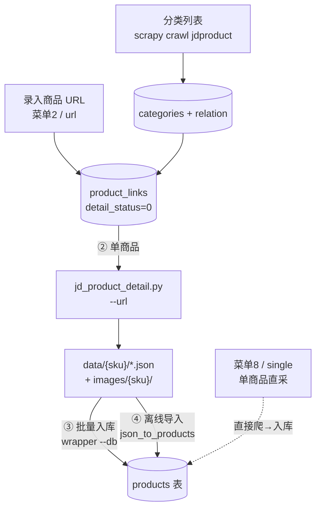

# 京东商品采集系统（Scrapy + DrissionPage）


> 在京东强反爬环境下，以「真实浏览器渲染 + 登录态复用」稳定获取结构化商品数据；并通过**分阶段解耦的流水线 + 白盒测试驱动的健壮性治理**，把一套采集脚本做成可维护、可演示的工程化系统。

---

## 一、项目价值与定位

京东商品页大量内容由前端 JS 动态渲染（含详情图懒加载），纯 `requests` 直连拿不到完整 DOM 与渲染后的数据。本项目的技术取舍：

- **采集侧**用 DrissionPage 驱动真实 Chromium，复用你已登录的浏览器会话（cookie / 信任分）省去登录环节、降低被风控拦截的概率；由浏览器原生执行 JS、拿到渲染后的页面，再用浏览器内 `run_js` 抽取动态 DOM，得到标题 / 价格 / 品牌 / SKU / 参数 / 评论等完整字段。
- **架构侧**把「采集」和「入库」拆成多个**可独立运行、用数据库解耦**的阶段，任一阶段失败都能单独重试，而非一竿子到底的脆弱脚本。
- **工程侧**用白盒测试 + 代码审查系统性地发现并修复了十余处健壮性问题（数据丢失、采集卡死、连接断开、非幂等写入等），并把测试、可观测性、产物治理做成项目规范。

适用场景：个人 / 毕设场景下的商品数据采集、数据分析前置、爬虫工程实践演示。

---

## 二、架构设计

### 2.1 整体流水线



四阶段（①②③④）既独立又可组合，阶段之间通过 MySQL 表解耦；`main.py` 只做编排，不替代任何阶段脚本，也不是调度器（无并发 / 定时）。

### 2.2 模块划分与职责

| 层 | 模块 | 职责 |
|----|------|------|
| 采集层（列表） | `jdcrawler/spiders/jdproduct.py` + `jdcrawler/pipelines.py` + `jdcrawler/middlewares.py` | Scrapy 调度、DrissionPage 中间件渲染、按 SKU 去重、缓冲批量入库 `product_links` |
| 采集层（详情） | `scripts/jd_product_detail.py` | DrissionPage 真浏览器打开详情页，慢速滚动触发懒加载，`run_js` 抽取字段，下载图片，落 `data/{sku}/` |
| 入库层 | `scripts/detail_crawler_wrapper.py` + `scripts/json_to_products.py` + `scripts/product_persist.py` | 统一入口：`--db` 实时爬 / `--from-json` 离线导入 / `--url` 单采；公共字段组装、动态截断、幂等 upsert |
| 数据访问层 | `scripts/db_connection.py` + `scripts/db_schema.py` | 连接（`ping` 重连）、建表、幂等补列 |
| 编排层 | `main.py` | 交互菜单 / 子命令，参数分层收集，登录态闸门 |
| 数据层 | MySQL `jd_data` | `categories` / `product_links` / `product_category_relation` / `products` / `crawl_session` |

### 2.3 关键设计决策

- **阶段解耦**：每个阶段只依赖前一段写入的表，失败可单独重跑（如详情失败只重爬 `detail_status=2`）。
- **配置分层**：`jdcrawler/settings.py` 提供默认值；`main.py` 菜单进入模块后逐项询问；子命令用默认值。旋钮只在 `settings.py` 暴露一处，避免重复与不一致。
- **可观测性**：`crawl_session` 记录每次运行的起止与成败；`RotatingFileHandler` 日志轮转；白盒测试不依赖外部资源。

---

## 三、技术栈

| 类别 | 选型 |
|------|------|
| 语言 | Python 3.10+ |
| 列表 / 调度 | Scrapy 2.11 |
| 浏览器渲染 | DrissionPage 4.x（驱动 Chromium，调试端口 9222） |
| 数据库驱动 | PyMySQL 1.1+ |
| HTTP（图片下载） | requests 2.31+ |
| 数据库 | MySQL 8.0（utf8mb4） |
| 测试 | unittest（标准库，白盒，假库 `RecordingCursor`） |
| 运行环境 | Windows；Chrome / Edge 等 Chromium 浏览器 |

---

## 四、核心功能

- 商品 URL 批量录入与去重（`product_links`，按 `sku_id` 唯一，`INSERT ... ON DUPLICATE`）。
- 单商品详情完整字段抽取：标题、副标题、价格、品牌、店铺、SKU、属性、标签、轮播图、详情图、描述、评论。
- 详情图**懒加载触发**：平滑慢速滚动（`_slow_scroll_to_load`）让背景图进入视口后再抽取，解决「瞬跳滚动导致详情图为 0」的问题。
- 图片**下载 + URL / 本地路径双写**，`download_images` 开关可在「只存 URL（更快更省空间）」与「下载到本地」之间切换。
- 评论抓取数量、滚动停顿**可配置**（菜单询问或 `--max-comments` / `--scroll-pause`）。
- **登录态闸门**：复用已登录浏览器会话，未登录则暂停等待，避免无登录态触发验证。
- **失败可重入**：`--retry-failed` 重爬 `detail_status=2` 的失败项。
- **离线导入**：已爬取的 JSON 不经浏览器直接入库（`--from-json`）。
- **运行会话记录**与状态枚举（`status_constants.py`），便于审计与排错。

---

## 五、目录结构

```
jd-product-crawler/
├── scrapy.cfg
├── main.py                   # 统一操作入口（菜单 / 子命令）
├── README.md  requirements.txt  .gitignore
├── jdcrawler/                        # Scrapy 项目包
│   ├── items.py  middlewares.py  pipelines.py  settings.py  status_constants.py
│   └── spiders/jdproduct.py      # 列表 / 分类采集 Spider（底层能力）
├── scripts/                   # 详情采集与入库工具（从根目录运行）
│   ├── jd_product_detail.py   # 单商品详情爬虫（~1900 行核心）
│   ├── detail_crawler_wrapper.py  # 详情采集统一入口（--db / --from-json / --url）
│   ├── json_to_products.py    # JSON → products 导入器（被 wrapper 复用）
│   ├── product_persist.py     # 公共入库逻辑：字段提取 / 动态截断 / 幂等 upsert
│   ├── db_connection.py       # 数据库连接（ping 重连，复用 jdcrawler/settings）
│   ├── db_schema.py           # 建表 / 幂等补列
│   ├── load_categories.py     # 分类种子导入
│   └── crawl_session.py       # 运行会话记录
├── docs/  ARCHITECTURE.md  SETUP.md  ROBUSTNESS.md  ANTI_SCRAPING.md  jd_product_detail.md
├── tests/  fakes.py + 多个 test_*.py（白盒，74 用例）
├── seeds/jd_categories_full.json   # 京东完整 4 级分类树种子
├── data/  images/  archive/        # 运行时产物（git 忽略）
```

---

## 六、运行流程

最简路径（详见 [docs/USAGE.md](./docs/USAGE.md)）：

1. 以调试端口启动 Chrome / Edge：`chrome.exe --remote-debugging-port=9222`；
2. `pip install -r requirements.txt`；
3. `python main.py` → 菜单 `2` 录入商品 URL → 菜单 `3` 详情批量入库；
4. 或菜单 `8` 直接采单个商品。

底层四阶段命令（分类列表、单商品爬取、批量入库、离线导入）仍可直接运行，见 USAGE.md 与 ARCHITECTURE.md。

---

## 七、数据库设计（MySQL `jd_data`）

| 表 | 角色 |
|----|------|
| `categories` | 分类树（id / path / parent_id / level / is_leaf / crawl_status），种子来自 `seeds/` |
| `product_links` | 待爬商品链接（id / sku_id / source_url / detail_status / detail_error），`id` 同时作为 `products.id` |
| `product_category_relation` | SKU↔分类多对多 |
| `products` | 商品主表（完整字段，见下） |
| `crawl_session` | 每次运行审计（起止 / 成败 / 类型） |

`products` 关键列：

- `id` 复用 `product_links.id`（两路径一致，避免 id 冲突）；
- 图片：`cover_image`（URL）/ `cover_image_local`（本地路径）、`shop_logo_local`；
- `gallery_json` / `detail_media_json`：JSON 数组，**每项 `{url, local_path}` 双写**；
- `comments_json` / `skus_json` / `attributes_json` / `tags_json`：结构化 JSON；
- `detail_status` 状态枚举：`0` 待爬 / `1` 成功 / `2` 失败（可重爬）。

写入 `products` 采用 `INSERT ... ON DUPLICATE KEY UPDATE`（按 `sku_id` 唯一索引），保证重试幂等、不重复。

---

## 八、京东平台技术难点（与应对）

> 本节聚焦**京东平台本身**带来的难点（强反爬、动态渲染、页面结构不稳定），而非通用爬虫工程问题。每条「问题 → 定位 → 解法 → 验证」完整过程见 **[`docs/TECHNICAL_NOTES.md`](./docs/TECHNICAL_NOTES.md)**；京东反爬机制的系统分析见 **[`docs/ANTI_SCRAPING.md`](./docs/ANTI_SCRAPING.md)**。下面只给结论式摘要。

**1. 详情页强反爬：验证码 + 登录态 + 行为风控**
- **平台难点**：京东对商品详情页防护最强——未登录、低信任会话会被弹验证码或重定向到验证页；请求频率、轨迹、指纹都会被风控；纯 HTTP 无头请求拿不到真实数据（详情页依赖运行时指纹）。
- **应对**：用 DrissionPage 驱动**本地已登录的真实浏览器**借信任分；16 项 `navigator` 指纹伪装绕过无头检测；预热访问 + 随机滚动、延迟、类人轨迹模拟真人；检测到验证码即**暂停等待人工验证或超时跳过**（不做自动识别）。权衡：刻意单并发降速换稳定性。

**2. 详情图懒加载（`background-image` 非 ``）**
- **平台难点**：京东详情图用 `background-image` 懒加载，元素不进视口附近不请求真实图，传统「拉到底」式瞬滚提取到 0 张。
- **应对**：`_slow_scroll_to_load()` 一屏一屏 `behavior:'smooth'` 平滑滚、每屏停顿，跟随懒加载带来的页面增长滚动到底。

**3. 参数表 / 评论区 DOM 动态且复杂**
- **平台难点**：规格参数区初始不渲染，需点击「店铺」标签才加载；评论区虚拟滚动（只渲染可视区），且不同区块用不同选择器（如 `.jdc-pc-rate-card`）。
- **应对**：浏览器内 `run_js` 一次性抽取主数据；参数区先点标签激活再提取；评论区循环滚动 + 提取直到连续多轮无新评论；多套选择器 + 兜底策略。

**4. 字段长度 / 结构不稳定 → 入库易失败**
- **平台难点**：不同品类商品字段字数、嵌套深度差异极大（长标题、大量 SKU），表结构不贴合时写入即报错；且部分接口会返回**200 空壳页**（状态码正常但无真实内容），需内容级校验。
- **应对**：读 `INFORMATION_SCHEMA` 动态截断超长字段并告警；入库前内容级校验（非空壳才落库）；`products` 主表用 JSON 列收纳 `attributes / skus / comments` 等变长结构。

**5. 搜索列表页翻页与反爬拦截**
- **平台难点**：分类搜索页同样有反爬，短响应、验证拦截会中断翻页，且翻页权在京东前端。
- **应对**：由 Spider 控制翻页节奏，逐页入库并标记分类状态；启动时仅把「爬取中」状态重置为「待爬」，已采到商品但中途中断的分类记为「部分完成」并在下次从断点页续爬，避免重爬白费请求与再次触发风控。

> 系统自身工程问题（产物路径随 cwd 漂移、GBK 终端编码、健壮性治理等）属于实现层，完整记录与修复见 **[`docs/ROBUSTNESS.md`](./docs/ROBUSTNESS.md)**，此处不展开。
---


## 九、测试与质量保障

- `tests/` 下 **74 个白盒用例**全部通过，覆盖 `load_categories`、`pipelines`、`jdproduct.parse_product_list`、`json_to_products`、`detail_crawler_wrapper`、`product_persist`、`jd_product_detail`、`main`（URL 解析）等。
- 不依赖真实 MySQL 与浏览器（内存假库 + Scrapy `HtmlResponse`），可快速回归。
- 健壮性修复均配套断言（如「异常路径不再静默丢数据」），详见 `docs/ROBUSTNESS.md`。

---

## 十、未来优化方向

> 以下为计划，**尚未实现**，未包含在当前代码中：

- 用 `logging` 统一日志分级（当前脚本以 `print` 输出）。
- 数据库连接池 / 复用，降低每条状态更新新建连接的开销。
- 代理池 / 多账号轮换，进一步提升抗封能力。
- 验证码自动识别或第三方打码（当前为人工或超时跳过）。
- 增量爬取与更细粒度去重。
- 单商品详情采集也登记 `product_links`（当前不经待爬库，不利于统一重爬 / 统计）。
- 数据导出（CSV / Excel）或轻量前端展示。

---

## 文档导航

- [docs/USAGE.md](./docs/USAGE.md) — 部署与完整使用手册（**先看这个**）
- [docs/ARCHITECTURE.md](./docs/ARCHITECTURE.md) — 架构、四阶段流水线、数据库设计细节
- [docs/SETUP.md](./docs/SETUP.md) — 安装、浏览器调试、数据库初始化
- [docs/ROBUSTNESS.md](./docs/ROBUSTNESS.md) — 健壮性分析与修复进度
- [docs/ANTI_SCRAPING.md](./docs/ANTI_SCRAPING.md) — 京东反爬机制与应对
- [docs/jd_product_detail.md](./docs/jd_product_detail.md) — 详情爬虫技术细节

---

## 许可证（License）

本项目采用 **MIT License** 开源，详见 [LICENSE](./LICENSE) 文件。

> 仅供学习与研究使用。使用本项目采集数据须遵守京东网站的服务条款与 `robots.txt`，
> 控制请求频率，不得用于任何商业或侵犯他人权益的用途；由此产生的责任由使用者自负。
