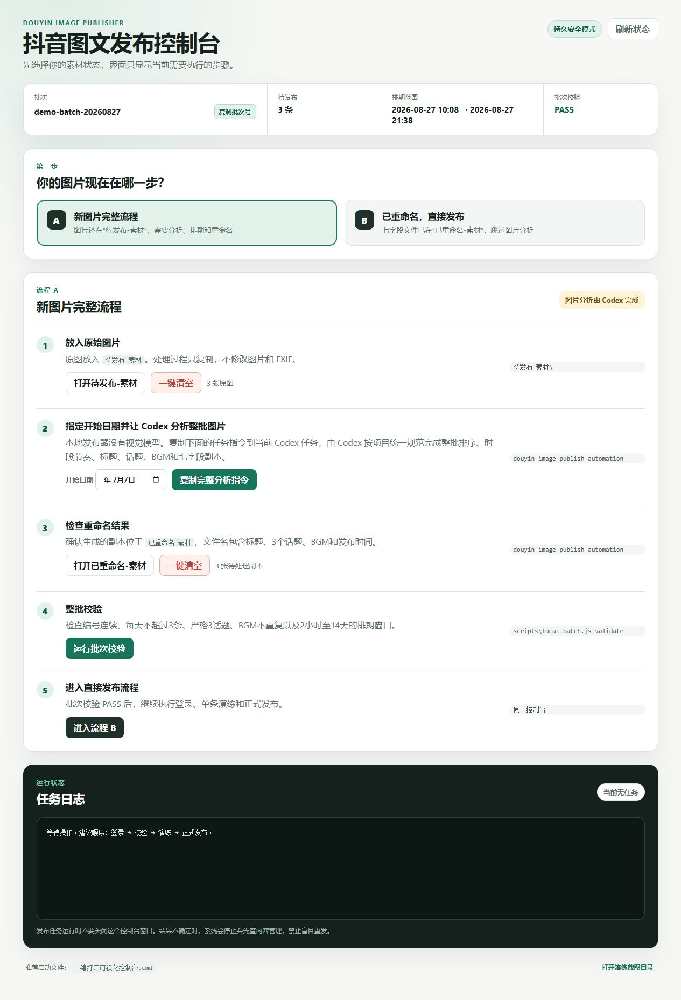
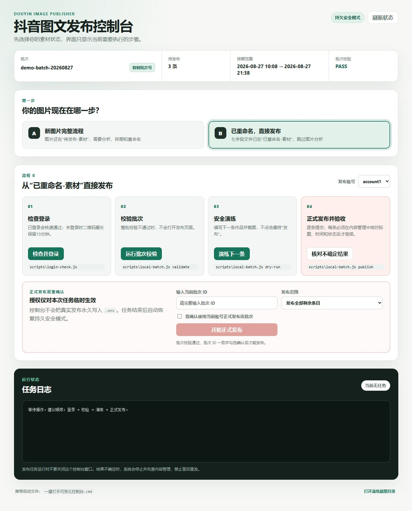

# 抖音图文发布器

[English](README.md) | 简体中文

一个本地优先的 Playwright RPA 控制台，用于准备、校验、演练和定时发布抖音图文内容。



项目将 Windows 可视化控制台、严格七字段批次格式、可选飞书多维表格接入和显式真实发布授权组合在一起，适用于你拥有或获授权运营的账号和内容。

> 本项目是独立社区项目，与抖音、字节跳动、飞书或 Lark 不存在隶属、背书或赞助关系。第三方页面变化可能导致浏览器自动化失效；请遵守平台规则并始终保留人工审核。

## 核心能力

- 本地可视化控制台，区分“新图片完整流程”和“已重命名后直接发布”。
- 多个已授权抖音账号使用独立浏览器登录目录。
- 单图单帖严格七字段文件名，包含标题、3 个话题、BGM、歌手和定时时间。
- 整批校验编号、标题长度、排期唯一性、每天最多 3 条、话题组合和 BGM 变体。
- 延长扫码窗口，校验上传预览、页面预检并保存安全演练截图。
- 真实发布同时受 dry-run 开关和精确批次授权 ID 约束。
- 提交后必须在内容管理页验收，才写入本地已发布台账。
- 结果不确定时只读核对，不会盲目重发。
- 可选飞书多维表格轮询和状态回写。

## 界面截图

| 新图片完整流程 | 已重命名后直接发布 |
|---|---|
|  |  |

截图使用虚构演示数据，不包含账号登录态、Cookie、二维码、真实人物图片或生产批次。

## 安全边界

- 可视化控制台只监听 `127.0.0.1`。
- 可选 HTTP 桥接默认也只监听本机；绑定非本机 `HOST` 时必须提供至少 16 字符且不是占位值的 `BRIDGE_SECRET`。
- 持久配置默认 `DOUYIN_DRY_RUN=true`。
- 真实发布还必须提供与当前批次完全一致的 `DOUYIN_AUTHORIZED_BATCH_ID`；控制台只对已确认子任务临时注入授权。
- 浏览器登录目录、`.env`、`config.json`、工作区素材、台账、下载媒体和运行截图均被 Git 忽略。
- 本地上传只允许配置的工作区/下载目录；飞书图片仅允许公网 HTTPS，最多跟随 3 次重定向，并校验 PNG/JPEG/WebP 文件签名和 20 MiB 体积上限。
- 两个“一键清空”按钮只永久删除固定工作区目录内容，必须显式确认，任务运行时禁止执行。

## 环境要求

- Windows 10 或 Windows 11。
- Node.js 20 或更高版本。
- 默认浏览器通道下需要 Google Chrome。
- 已获授权访问的抖音创作者中心账号。
- 可选：具备多维表格读写权限的飞书/Lark 内部应用。

浏览器 RPA 建议运行在已登录的桌面会话中。无桌面纯后台或无人值守服务器可靠性更低，也可能与平台要求冲突。

## 快速开始

```powershell
git clone git@github.com:wyg916/douyin-fabu.git
cd douyin-fabu
npm.cmd ci
Copy-Item .env.example .env
Copy-Item config.example.json config.json
New-Item -ItemType Directory -Force workspace\待发布-素材, workspace\已重命名-素材
Copy-Item 发布配置.example.json workspace\发布配置.json
npm.cmd run panel
```

编辑 `workspace\发布配置.json`，填写有效开始日期和全新唯一批次 ID，然后打开 <http://127.0.0.1:3400/>。也可以双击 `一键打开可视化控制台.cmd`。

运行项目完整检查：

```powershell
npm.cmd run check
```

## 工作区与七字段格式

默认工作区已被 Git 忽略：

```text
workspace/
├─ 待发布-素材/
├─ 已重命名-素材/
└─ 发布配置.json
```

每张已准备图片严格使用 7 个半角连字符字段：

```text
图片NN-第NN条发布内容-标题-#话题1 #话题2 #话题3-BGM歌名-歌手-YYYY年MM月DD日HH时mm分.jpg
```

文件名错误、编号不连续、单条不是 1 张图片、标题超过 15 字、不是严格 3 个话题、排期重复、每天超过 3 条、BGM 变体重复或排期不在 2 小时至 14 天窗口内，都会被整批拒绝。

只做离线校验：

```powershell
npm.cmd run validate:local
```

## 流程 A：准备新图片批次

1. 把原图放入 `workspace\待发布-素材`。
2. 在控制台选择开始日期。
3. 如果已安装可选的 `douyin-image-publish-automation` 技能，把控制台生成的分析指令复制到 Codex 任务。
4. 校验生成的结构化计划：

```powershell
npm.cmd run validate:content-plan -- "<发布计划.json 路径>" --start-date YYYY-MM-DD
```

5. 保持原图不变，把七字段重命名副本放入 `workspace\已重命名-素材`。
6. 运行整批校验。

本地发布器自身不包含图片视觉理解模型。图片分析是独立、可选的准备步骤；完成重命名后，校验和素材读取均可离线执行，直到需要打开浏览器。

## 流程 B：登录、演练与发布

```powershell
npm.cmd run login:account1
npm.cmd run dry-run:local -- --account account1 --limit 1
npm.cmd run dry-run:local -- --account account1 --all
```

真实发布时，下面两个值必须与已审核批次一致：

```env
DOUYIN_DRY_RUN=false
DOUYIN_AUTHORIZED_BATCH_ID=<当前批次ID>
```

```powershell
npm.cmd run publish:local -- --account account1 --all
```

日常更推荐可视化控制台，因为真实发布授权仅对当前任务临时生效。结果不确定时，在任何新发布尝试前运行：

```powershell
npm.cmd run reconcile:local -- --account account1
```

## 环境变量

复制 `.env.example` 为 `.env`。路径变量留空时使用安全本地默认目录。

| 变量 | 是否必需 | 默认值 | 用途 | 敏感 |
|---|---:|---|---|---:|
| `HOST` | 否 | `127.0.0.1` | 可选 HTTP 桥接监听地址 | 否 |
| `PORT` | 否 | `3300` | HTTP 桥接端口 | 否 |
| `BRIDGE_SECRET` | 非本机监听时 | 空 | 验证桥接请求 | 是 |
| `DOUYIN_HEADLESS` | 否 | `false` | 是否隐藏浏览器窗口 | 否 |
| `DOUYIN_DRY_RUN` | 否 | `true` | 持久真实发布门禁 | 否 |
| `DOUYIN_BROWSER_CHANNEL` | 否 | `chrome` | Playwright 浏览器通道 | 否 |
| `DOUYIN_WORKSPACE_DIR` | 否 | `./workspace` | 本地批次工作区 | 可能暴露路径 |
| `DOUYIN_LOCAL_IMAGE_DIR` | 否 | 工作区子目录 | 已准备图片目录 | 可能暴露路径 |
| `DOUYIN_BATCH_CONFIG` | 否 | 工作区 JSON | 发布配置路径 | 可能暴露路径 |
| `DOUYIN_AUTHORIZED_BATCH_ID` | 真实发布时 | 空 | 精确批次授权 | 运行数据 |
| `LARK_APP_ID` | 使用飞书时 | 空 | 飞书/Lark 应用 ID | 是 |
| `LARK_APP_SECRET` | 使用飞书时 | 空 | 飞书/Lark 应用密钥 | 是 |
| `FEISHU_BASE_TOKEN` | 使用飞书时 | 空 | 默认多维表格 Token | 是 |

非本机监听前，在本地生成随机密钥并只写入 `.env`：

```powershell
node -e "console.log(require('crypto').randomBytes(32).toString('hex'))"
```

## 可选飞书流程

调度器只处理已审核且处于有效排期窗口的记录。正式调度发布还要求记录批次 ID 与 `DOUYIN_AUTHORIZED_BATCH_ID` 完全一致。

不满足发布前置条件的记录会在进入浏览器自动化之前逐条判定并跳过：整轮不会中止，该条会写回 `发布状态=跳过` 与 `发布失败原因`，原因能区分“持久干跑未关闭”（`DOUYIN_DRY_RUN=true`，此时不写回任何飞书状态）和“批次号不匹配”（同时带上记录批次号与授权批次号）。同轮其余记录继续处理；每轮结束输出每条记录的表、记录号、结局（`已发布`/`干跑完成`/`跳过`/`失败`）与原因。

```powershell
npm.cmd run scheduler:once
npm.cmd run scheduler
npm.cmd start
npm.cmd run health
```

没有经过独立威胁评估、TLS、认证反向代理和网络访问控制时，不要把 HTTP 桥接暴露到互联网。

## Docker

容器运行可选 HTTP 桥接，而不是交互式 Windows 控制台。容器内监听 `0.0.0.0`，因此没有强 `BRIDGE_SECRET` 时会拒绝启动。

```bash
docker build -t douyin-fabu .
docker run --rm -p 127.0.0.1:3300:3300 \
  -e BRIDGE_SECRET=replace-with-a-local-secret \
  douyin-fabu
```

不要把 `.env`、浏览器登录目录或真实素材写入镜像。

## 项目结构

```text
control-panel.js              仅本机监听的可视化控制台
public/                       控制台前端
publish-policy.js             严格批次和授权策略
local-batch.js                批次、台账和尝试记录
douyin.js                     Playwright 自动化与验收
feishu.js                     可选飞书/Lark 接入
scripts/                      命令行入口
test/                         Node 自动测试
docs/image-content-planning.md 可选图文策划合同
```

## 已知限制

- 抖音页面选择器和文字可能随时变化。
- 扫码登录、内容检查、音乐搜索和平台审核均受第三方控制。
- 控制台以 Windows 为主，并使用 Explorer 打开目录。
- 永久清空目录无法由本项目恢复。
- 本项目只能核对创作者中心中可观察到的状态，不能保证平台最终接受内容。

## 贡献与安全

请阅读 [贡献指南](CONTRIBUTING.md)、[安全策略](SECURITY.md)、[支持范围](SUPPORT.md) 和 [行为准则](CODE_OF_CONDUCT.md)。Issue 中禁止附带真实登录目录、Cookie、二维码、Token、人物图片或未脱敏运行截图。

## 致谢

本仓库最初基于 MIT 许可证发布的 [FKZn10/douyin-rpa-publisher](https://github.com/FKZn10/douyin-rpa-publisher)。当前项目保留其 Git 历史，并增加了严格本地批次流程、可视化控制台、真实发布门禁、不确定结果核对、测试和开源安全加固。

## 许可证

[MIT](LICENSE)
