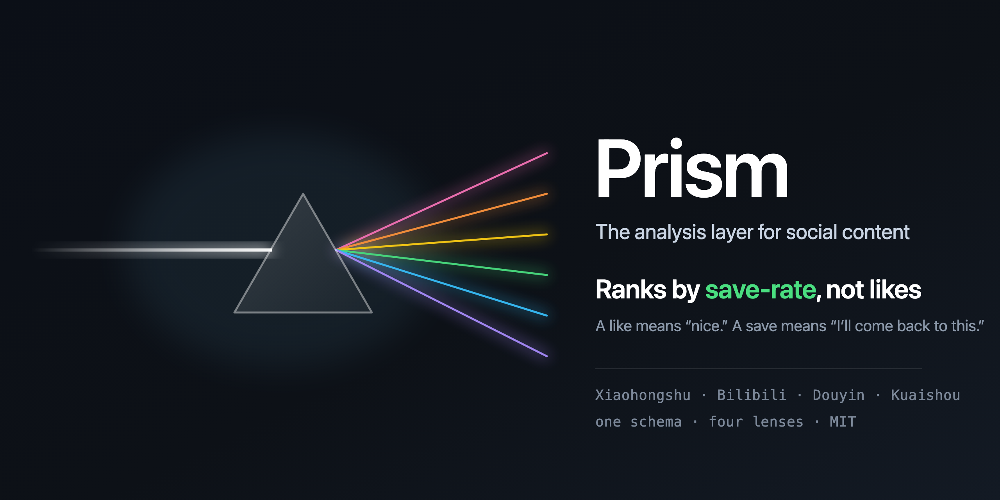

# Prism · 棱镜

<p align="center">
  
</p>


> 🇬🇧 English: [README.md](./README.md)

**平台无关的内容调研框架** — 一束内容数据射入，多维洞察透出（定量 / 情感 / 时序 / 预测）。

**已支持四个平台**：小红书 / B站 / 抖音 / 快手。同一套通用五表 + 四维分析，换平台只写一个新 adapter。核心信号是**收藏率**（非点赞），配置化抗改版，合规脱敏。

### Prism 的位置

开源世界已经有很成熟的**采集器**，真正缺的是采集器*之上*那一层 —— 把原始抓取变成结构化、可对比、可导出的洞察。Prism 就是这层分析层。

- **面向**：想*自己掌控*数据、而非租用黑盒面板的技术型运营、独立开发者、中小数据团队。
- **数据自带**：Prism 讲一套通用五表，喂它内置 adapter、[MediaCrawler](https://github.com/NanmiCoder/MediaCrawler) 导出或任意来源都行（见下方「自带数据」）。
- **为什么不用 SaaS**：商业工具闭源、按平台割裂、按品牌定价；Prism 开源、*一套*统一口径跨平台、可完全私有化部署。

---

## ✨ 特性

- 🕵️ **抓取**：复用 cookies + 解析帖子页 `window.__INITIAL_STATE__`，无需第三方 API
- 🗄️ **通用五表 schema**：`entities`(博主) / `items`(笔记) / `metrics`(赞藏评长表) / `texts`(评论·正文) / `features`(AI 分析)，跨平台可对比
- 📊 **分析**：定量 `quant` / 情感 `sentiment`(走本地 LLM，可配置 OpenAI 兼容端点) / 时序 `timeseries` / 预测 `forecast`(线性回归回测)
- 🎯 **小红书专精**：⭐ **收藏率为核心指标**(非点赞) / 封面图分析 / 话题标签时效 / 图文 vs 视频
- ⚙️ **配置化抗改版**：字段映射外置 `framework/config/*.yml`，小红书改版**只改 yml 不改代码**
- 🛡️ **合规脱敏**：用户 ID 加盐 HMAC 哈希 + 丢敏感字段 + 速率限制防封

---

## 📦 安装

```bash
git clone https://github.com/millennialdreamer/prism.git
cd prism
pip install -e ".[forecast]"        # forecast 可选(装 scikit-learn)
```

### 配置 cookies（两种方式）

**方式 A — macOS 自动读 Chrome（推荐，零手动操作）**

本机已用 Chrome 登录小红书 → 直接从 Chrome profile 自动读 + 解密 cookies，无需手动导出：

```python
adapter = xhs.XHSAdapter(chrome_profile="Default")   # Default=默认profile；多 profile 见下
```

> 依赖 `pycryptodome`（装：`pip install -e ".[cookies]"`）；首次会弹一次 Keychain 授权（点「允许」）。仅 macOS。
> `python3 -m framework.adapters.xhs_cookies` 可自检各 profile 小红书登录态（只报数量，不打印明文）。

**方式 B — 手动导出 cookies.json（通用，跨平台 / CI / 非 Chrome）**

Chrome 登录小红书 → 按 `F12` 打开 Console → 运行下面这段（把 cookies 复制到剪贴板）→ 存为 `~/cookies.json`：

```javascript
copy(JSON.stringify(document.cookie.split('; ').map(c => {
  const [name, ...r] = c.split('=');
  return { name, value: r.join('='), domain: '.xiaohongshu.com', path: '/' };
})))
```

> ⚠️ `~/cookies.json` 含登录态，已被 `.gitignore` 拦截，**切勿提交**。约 30 天过期，失效后重新导出。

---

## 🚀 快速开始

### 30 秒看效果（零配置、不联网）

```bash
pip install -e ".[forecast]"
prism demo
```

约一秒后输出：

<p align="center">
  
</p>

<details>
<summary>同样内容的可复制文本</summary>

```
① Collect-rate ranking (save/like — Prism's core signal):
    2.38  save   1520 / like    640   Every visa document I needed, in order
    1.82  save   1655 / like    910   Reading a rental contract line by line
    1.82  save   1490 / like    820   How to pick a rice cooker without overpaying
     1.6  save   1980 / like   1240   12 museums in the city that are free on Sunda…
    1.24  save   2610 / like   2100   Beginner sourdough: the whole schedule on one…

② By content type (avg saves):
   image    n=9    avg_save=1748
   video    n=11   avg_save=693

③ Save distribution: n=20 median=940 p90=1980 max=2610
④ Save concentration: HHI=657 top3-share=0.284
```

</details>

排在收藏率前列的**全是攻略类**。同一批数据改按点赞排，出来的是猫和日落——两份完全不同的榜单。这就是 Prism 坚持按收藏率排序的理由。


```python
# 1) 纯解析(无需 cookies,可用 mock HTML 测试)
from framework.adapters.xhs import parse_initial_state, extract_note, note_to_records

note = extract_note(parse_initial_state(html))          # html = 帖子页源码
entity, item, metrics, texts = note_to_records(note)
# metrics 含 like_count / collect_count(收藏) / comment_count；entity 已脱敏(anon_id)

# 2) 真抓(需 cookies,内置慢速率防封)
from framework.adapters import xhs
adapter = xhs.XHSAdapter(chrome_profile="Default")      # macOS 自动读;或 cookies_path="~/cookies.json"

# 单篇
records = adapter.fetch_note_by_url("https://www.xiaohongshu.com/explore/<note_id>")
# 批量抓首页推荐流(feed→逐详情拿收藏); 端到端 demo 见 examples/fetch_live.py
batch = adapter.fetch_feed(limit=10)                     # [(entity, item, metrics, texts), ...]
```

---

## 自带数据

内置 adapter 只是填充 schema 的一种方式，不是唯一方式。手里已经有数据了——MediaCrawler
导出、同事发来的 CSV、自己爬虫的产出——导进来，整个分析层照样零改动跑：

```python
from framework.store import Store
from framework.importers import import_csv

store = Store("research.db")
import_csv(store, "xhs_notes.csv", platform="xhs", preset="mediacrawler_xhs")
# {'items': 1204, 'metrics': 4816, 'texts': 1180, 'entities': 87, 'skipped': 0}
```

预设内置了 MediaCrawler 的小红书和 B 站导出格式。其他格式，把列名描述一次就行：

```python
from framework.importers import import_rows, FieldMap

import_rows(store, rows, platform="my_platform", mapping=FieldMap(
    item_id="post_id", title="headline", author_id="user",
    metrics={"like_count": "likes", "collect_count": "saves"}))
```

作者 ID 入库前一样走加盐哈希——导入不是绕开脱敏的后门。

## 🏗️ 架构

```
prism/
├── compliance.py              # 脱敏(scrub_user / anon_id) + 速率限制(RateLimiter)
├── config/
│   └── xhs_selectors.yml      # 字段映射配置(小红书改版只改这里)
├── framework/
│   ├── adapter.py             # 数据契约 Entity/Item/Metric/Text + SourceAdapter 接口
│   ├── schema.sql             # 通用五表
│   ├── store.py               # 落库层(所有平台共用)
│   ├── adapters/xhs.py        # 小红书适配器(解析纯函数 + 抓取 + fetch_feed 批量)
│   ├── adapters/xhs_cookies.py# macOS Chrome cookie 自动读解密(便利层,可选)
│   └── analysis/              # quant / sentiment / timeseries / forecast
├── DISCLAIMER.md   LICENSE   pyproject.toml
```

- **adapter** 把平台数据翻译成统一契约 → **store** 落五表 → **analysis** 走通用表(跨平台复用)
- **收藏(collect) 与点赞并列一级指标** —— 小红书的内容价值靠"收藏"衡量，这是与 YouTube/抖音最大的不同

---

## ⚖️ 合规

仅供**学习与研究**。数据入库前脱敏（用户 ID 加盐哈希、丢手机/IP/昵称等敏感字段），内置速率限制防止账号被封。详见 **[DISCLAIMER.md](./DISCLAIMER.md)**。

## 📄 License

[MIT](./LICENSE)。
