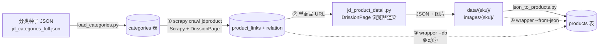

# 架构说明（ARCHITECTURE）

本文档说明京东商品采集系统的整体架构、数据采集流水线、目录结构与数据库设计。
运行与安装步骤见 [SETUP.md](./SETUP.md)。

---

## 1. 项目定位

基于 **Scrapy + DrissionPage** 的京东商品采集系统。

- **Scrapy**：负责任务调度、请求编排、去重与入库管道。
- **DrissionPage**：驱动真实 Chromium 浏览器渲染京东页面，由浏览器原生执行 JS（前端加密逻辑由浏览器处理，无需在代码层逆向接口），并用浏览器内 `run_js` 抽取渲染后的动态 DOM 数据。

> 注意：本项目早期曾叫"京东图书爬虫"，现已演进为**通用京东商品采集**，与旧 README 描述不同，请以本仓库代码与文档为准。

---

## 2. 四阶段采集流水线

整个采集过程分为四个既独立又可组合的阶段：



| 阶段 | 入口 | 输入 | 输出 | 说明 |
|------|------|------|------|------|
| ① 列表采集 | `scrapy crawl jdproduct` | `categories` 表（三级叶子分类） | `product_links` + `product_category_relation` | 逐分类渲染搜索页，翻页权在 Spider，逐页入库 |
| ② 详情爬取 | `scripts/jd_product_detail.py --url <url>` | 单个商品 URL | `data/{sku}/product_{sku}.json` + `images/{sku}/` | 浏览器内 JS 抽取完整字段并下载图片 |
| ③ 批量入库 | `scripts/detail_crawler_wrapper.py --db` | `product_links`（detail_status=0） | `products` 表 | 包装②，从 DB 取未爬 URL 批量爬并写库 |
| ④ JSON 导入 | `scripts/detail_crawler_wrapper.py --from-json` | `data/` 下 JSON | `products` 表 | 离线模式，无需浏览器，复用 `json_to_products` |

> **简化入口**：为降低使用门槛，可用 `python main.py` 进入交互菜单，或 `python main.py all` 一键跑完上述四阶段。它只做流程编排与友好提示，不替代各阶段脚本，也不是调度器（无并发 / 定时）。

---

## 3. 目录结构

```
jd-product-crawler/
├── scrapy.cfg                 # Scrapy 部署配置
├── main.py                   # 统一操作入口（菜单/子命令，简化四阶段流程）
├── README.md                  # 项目说明（与代码同步）
├── requirements.txt           # Python 依赖
├── .gitignore
├── jdcrawler/                        # Scrapy 项目包
│   ├── __init__.py
│   ├── items.py               # JdItem 定义（仅 SKU 链接相关字段）
│   ├── middlewares.py         # DrissionPageMiddleware：用浏览器渲染页面
│   ├── pipelines.py           # JdPipeline(去重) + MysqlPipeline(批量入库)
│   ├── settings.py            # 全局配置（DB、爬取控制、浏览器、日志轮转）
│   ├── status_constants.py    # 状态枚举常量（L4：CategoryCrawlStatus / DetailStatus）
│   └── spiders/
│       ├── __init__.py
│       └── jdproduct.py          # 列表采集 Spider
├── scripts/                   # 独立脚本（详情采集与入库工具）
│   ├── jd_product_detail.py   # ② 单商品详情爬虫
│   ├── detail_crawler_wrapper.py  # ③/④ 详情采集统一入口（--db / --from-json / --url）
│   ├── json_to_products.py    # ④ 的底层 JSON→products 导入器
│   ├── db_connection.py       # 数据库连接（复用 jdcrawler/settings 配置）
│   ├── product_persist.py     # 公共入库逻辑：字段提取/动态截断/UPSERT（M3/M5）
│   ├── crawl_session.py       # 运行会话记录（L3）
│   └── debug_table.py         # 调试 products 表字段的小工具
├── docs/                      # 文档
│   ├── ARCHITECTURE.md        # 本文档
│   ├── SETUP.md               # 安装与运行指南
│   ├── ROBUSTNESS.md          # 健壮性分析与修复进度
│   ├── ANTI_SCRAPING.md       # 京东反爬机制分析与设计应对
│   └── jd_product_detail.md   # 详情爬虫技术细节
├── tests/                     # 白盒测试（unittest，不依赖浏览器/真实 DB）
│   ├── fakes.py               # 假库/假连接
│   ├── test_load_categories.py / test_pipelines.py / test_jdproduct.py
│   ├── test_json_to_products.py / test_wrapper.py / test_product_persist.py
├── seeds/
│   └── jd_categories_full.json  # 京东完整分类树（4 级，导入 categories 表的种子数据）
├── data/                      # 运行时：商品 JSON（git 忽略）
├── images/                    # 运行时：商品图片（git 忽略）
└── archive/                   # 旧版本 / 压缩包归档（git 忽略）
```

> 所有 `scripts/` 下的命令均**从项目根目录运行**（脚本内部按文件位置计算项目根，无需切换目录）。

---

## 4. 数据库设计（MySQL，库名 `jd_data`）

共四张表，角色如下：

### 4.1 categories（分类表）
| 字段 | 类型 | 说明 |
|------|------|------|
| id | INT PK | 自增主键 |
| category_id | VARCHAR(50) | 京东分类 ID |
| name | VARCHAR(100) | 分类名称 |
| level | TINYINT | 分类层级（1~4） |
| parent_id | VARCHAR(50) | 父分类 ID |
| url | VARCHAR(500) | 分类搜索 URL |
| leaf | TINYINT | 是否叶子分类（1=是） |
| crawl_status | TINYINT | 列表采集状态（见下方状态枚举） |
| created_at | TIMESTAMP | 创建时间 |

### 4.2 product_links（商品链接表）
| 字段 | 类型 | 说明 |
|------|------|------|
| id | BIGINT PK | 自增主键，同时作为 products 表的外键 id |
| sku_id | VARCHAR(50) | 商品 SKU |
| source_url | VARCHAR(500) | 商品详情页 URL |
| category_id | VARCHAR(50) | 所属分类 |
| crawl_status | TINYINT | 列表采集状态（见下方状态枚举） |
| detail_status | TINYINT | 详情采集状态（见下方状态枚举） |
| detail_crawled_at | DATETIME | 详情最近爬取时间 |
| detail_error | TEXT | 详情爬取失败信息 |
| created_at | TIMESTAMP | 创建时间 |

### 4.3 product_category_relation（SKU↔分类关联表）
| 字段 | 类型 | 说明 |
|------|------|------|
| sku_id | VARCHAR(50) | 商品 SKU |
| category_id | VARCHAR(50) | 分类 ID |

### 4.4 products（商品主表）
完整商品详情。关键字段（详见 `scripts/json_to_products.py` 中的建表语句）：

`id, sku_id, category_id, merchant_id, title, sub_title, brand, shop_name,
cover_image, gallery_json(JSON), detail_media_json(JSON), description,
price, original_price, sales, stock, comment_count, rating, favorite_count,
attributes_json(JSON), tags_json(JSON), skus_json(JSON), comments_json(JSON),
source, source_url, status, created_at, updated_at`

`products.id` 复用 `product_links.id`，保证链接与详情一一对应。

### 4.5 crawl_session（运行会话表，健壮性 L3）
记录每次批量爬取 / 导入的开始、结束与成功失败数，便于中断后审计。

- `run_type='detail_crawl'`：由 `detail_crawler_wrapper.crawl_from_db` 写入（实时批量爬取）
- `run_type='json_import'`：由 `json_to_products.import_directory` 写入（离线导入）
- `run_type='list_crawl'`：由 `jdcrawler/spiders/jdproduct.py` 的 `spider_opened`/`spider_closed` 写入（列表采集；`total`=分类总数，`success`/`failed`=本次运行成功/失败分类数）

| 字段 | 类型 | 说明 |
|------|------|------|
| id | BIGINT PK | 自增主键 |
| run_type | VARCHAR(32) | 运行类型：`detail_crawl`（实时批量）/ `json_import`（离线导入）/ `list_crawl`（列表采集） |
| started_at | DATETIME | 开始时间 |
| finished_at | DATETIME | 结束时间 |
| total | INT | 本次处理总数 |
| success | INT | 成功数 |
| failed | INT | 失败数 |
| note | TEXT | 备注（如 limit、目录） |

---

## 4.6 状态枚举（健壮性 L4，统一语义）

两套状态字段的取值范围在 `jdcrawler/status_constants.py` 中以常量统一定义，避免误用。

### categories.crawl_status（列表采集阶段）
| 值 | 常量 | 含义 |
|----|------|------|
| 0 | `CategoryCrawlStatus.PENDING` | 待爬取 |
| 1 | `CategoryCrawlStatus.CRAWLING` | 爬取中（start 标记） |
| 2 | `CategoryCrawlStatus.DONE` | 已爬取完成 |
| 3 | `CategoryCrawlStatus.FAILED` | 爬取失败（短响应被反爬 / 首页请求失败） |

> 启动时会把 `IN (1, 3)` 的分类重置为 `0`（复苏"死分类"，修复 H1）。

### product_links.detail_status（详情采集阶段）
| 值 | 常量 | 含义 |
|----|------|------|
| 0 | `DetailStatus.PENDING` | 待爬取 |
| 1 | `DetailStatus.SUCCESS` | 已成功入库 |
| 2 | `DetailStatus.FAILED` | 爬取/入库失败（批量爬取中途也临时用 2 标记"采集中"，成功后改写为 1） |

> 仅 `detail_status=0` 会被 `--db` 批量爬取；`--retry-failed` 重爬 `=2` 的失败项。

---

## 5. 关键配置（jdcrawler/settings.py）

| 配置项 | 默认值 | 说明 |
|--------|--------|------|
| MYSQL_* | root / 123456 / jd_data | 数据库连接信息 |
| CATEGORY_LIMIT | 1 | 列表采集分类数（0=全部），默认仅 1 个便于测试 |
| MAX_PAGES | 20 | 每分类最大翻页数 |
| ITEMS_PER_CATEGORY | 0 | 每分类采集商品数（0=不限） |
| EDGE_ADDRESS | 127.0.0.1:9222 | DrissionPage 连接的浏览器调试地址（变量名虽含 EDGE，但与具体浏览器无关，Chrome/Edge 皆可） |
| DOWNLOAD_DELAY | 4 | 请求间隔（秒），配合 RANDOMIZE 防止触发验证 |
| CONCURRENT_REQUESTS | 1 | 并发请求数（刻意降速防封） |

---

## 6. 反爬策略（概述）

系统在京东强反爬环境下的应对策略分为四层：

- **浏览器级**：DrissionPage 驱动真实 Chromium，16 项 `navigator` 指纹伪装，绕过无头检测。
- **行为级**：预热访问、随机滚动、随机延迟、模拟人类操作轨迹。
- **容错级**：验证码检测 + 人工验证等待（`--wait-for-manual-verify`）、UA 轮换、失败重试。
- **速率级**：单并发 + 固定下载延迟，规避京东风控。

关于京东反爬机制的深入分析与本系统的设计应对（解决的问题、反爬心得、关键设计权衡），
单独整理在 [docs/ANTI_SCRAPING.md](./ANTI_SCRAPING.md)。

---

## 7. 相关文档

- **[TECHNICAL_NOTES.md](./TECHNICAL_NOTES.md)**：本项目「遇到什么问题 → 怎么定位 → 怎么修 → 验证」的**解题实录**（含代码片段），涵盖详情图懒加载、双 `data` 目录错位、GBK 终端崩溃、图片 URL+本地双写、评论数可配、健壮性专项等。
- **[ROBUSTNESS.md](./ROBUSTNESS.md)**：白盒测试驱动的健壮性缺陷清单（H1–H3 / M1–M8 / L1–L4）与修复记录。
- **[SETUP.md](./SETUP.md) / [USAGE.md](./USAGE.md)**：部署与运行手册。
- **[jd_product_detail.md](./jd_product_detail.md)**：详情爬虫 `jd_product_detail.py` 的字段与提取逻辑细节。
