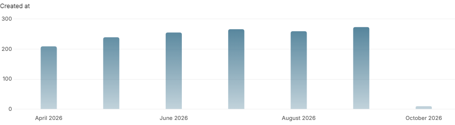
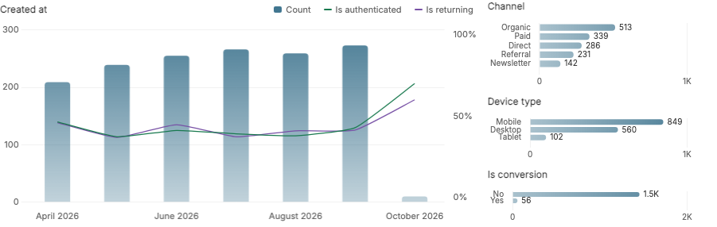

# Useful charts from one mixin

<!-- gallery:start -->



<!-- gallery:end -->

Install from a checkout with `python -m pip install .`, add `'admin_list_charts'` to `INSTALLED_APPS`, and mix it into a stock Django admin:

```python
from django.contrib import admin
from admin_list_charts.admin import ListChartMixin
from .models import Order

@admin.register(Order)
class OrderAdmin(ListChartMixin, admin.ModelAdmin):
    pass
```

Dates, choices and booleans are discovered automatically. Charts follow search and filters across all results. The package includes local assets and supports Django’s light and dark themes.

Charts appear above the admin list controls and follow search and filters across all results. The initial view shows only the timeline. Django’s **Show counts** enables boolean rate overlays and standard distributions. On wide containers all charts share one row: the timeline takes at least two-thirds of the width, with up to three compact distributions stacked beside it. A third distribution is shown only when the first two have fewer than 10 categories combined, and the row grows slightly (at most 320px) to fit it; distributions that do not fit are left out. Narrow containers stack distributions below the timeline. The timeline plot is 216px high unless the row grows. Light, dark and automatic themes work without configuration. Use arrow keys on a focused chart to explore points and Enter to filter.

- [Gallery and runnable examples](gallery.md)
- [Automatic discovery and optional hooks](advanced.md)
- [Python and Django compatibility](compatibility.md)
- [Query budgets and performance](performance.md)
- [Upgrading to 0.5.1](migration.md)
- [Changelog](changelog.md)
