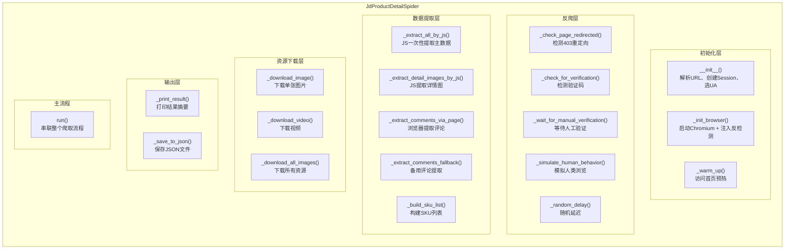

# 京东商品详情页爬虫 技术文档

> **文件**: `jd_product_detail.py` | **版本**: v1.0 | **日期**: 2026-05-23

---

## 目录

- [1. 概述](#1-概述)
- [2. 快速开始](#2-快速开始)
- [3. 依赖环境](#3-依赖环境)
- [4. 整体架构](#4-整体架构)
- [5. 类结构与方法清单](#5-类结构与方法清单)
- [6. 运行流程](#6-运行流程)
- [7. 数据提取模块（JS注入）](#7-数据提取模块js注入)
  - [7.1 标题提取](#71-标题提取)
  - [7.2 分类ID提取](#72-分类id提取)
  - [7.3 价格提取](#73-价格提取)
  - [7.4 品牌与参数提取](#74-品牌与参数提取)
  - [7.5 轮播图提取](#75-轮播图提取)
  - [7.6 商品视频提取](#76-商品视频提取)
  - [7.7 店铺信息提取](#77-店铺信息提取)
  - [7.8 SKU选项提取](#78-sku选项提取)
  - [7.9 服务标签提取](#79-服务标签提取)
  - [7.10 详情图提取](#710-详情图提取)
  - [7.11 评论提取](#711-评论提取)
- [8. JSON输出数据结构](#8-json输出数据结构)
  - [8.1 商品主表](#81-商品主表)
  - [8.2 SKU列表](#82-sku列表)
  - [8.3 评论列表](#83-评论列表)
- [9. 图片下载](#9-图片下载)
- [10. 反爬策略](#10-反爬策略)
- [11. 常量定义](#11-常量定义)

---

## 1. 概述

`jd_product_detail.py` 是一个基于 `DrissionPage` 的京东商品详情页通用爬虫。通过浏览器自动化 + JS注入的方式，从京东商品页面提取完整的商品数据，包括标题、价格、品牌、参数、轮播图、SKU、店铺、服务、详情图、评论等，并下载所有图片/视频资源到本地。

**核心特点：**

- 使用 `DrissionPage` 驱动真实 Chromium 浏览器，避免直接请求HTML被拦截
- 通过 `page.run_js()` 在浏览器中执行 JS 脚本，精准提取 DOM 数据
- 支持16项浏览器指纹伪装，降低被反爬检测的概率
- 支持虚拟滚动/懒加载评论的提取
- 支持多尺寸图片（1440/800/228）的生成与下载
- SKU按分组/类别组织，适配不同品类商品

---

## 2. 快速开始

```bash
# 安装依赖
pip install DrissionPage requests

# 运行爬虫
python jd_product_detail.py --url https://item.jd.com/100012043978.html
```

**命令行参数：**

| 参数 | 必填 | 说明 | 示例 |
|------|------|------|------|
| `--url` | 是 | 京东商品URL | `--url https://item.jd.com/100012043978.html` |

---

## 3. 依赖环境

| 库名 | 用途 |
|------|------|
| `DrissionPage` | 浏览器自动化核心（`ChromiumPage`, `ChromiumOptions`） |
| `requests` | HTTP请求（图片/视频下载、Session管理） |
| `re` | 正则表达式（URL提取SKU ID、参数匹配等） |
| `os` | 文件/目录操作 |
| `json` | JSON序列化/反序列化 |
| `time` | 延迟/等待 |
| `random` | 随机数生成（延迟、UA选择、模拟数据） |
| `datetime` | 时间戳生成 |

---

## 4. 整体架构



---

## 5. 类结构与方法清单

### `JdProductDetailSpider`

| 方法 | 功能 | 参数 | 返回值 |
|------|------|------|--------|
| `__init__(product_url, enable_anti_detect, wait_for_manual_verify, image_save_dir)` | 初始化爬虫实例 | `product_url`: 商品URL; `enable_anti_detect`: 是否反检测(默认True); `wait_for_manual_verify`: 是否等待人工验证(默认True); `image_save_dir`: 图片目录(默认"images") | 无 |
| `_random_delay(min_s, max_s)` | 随机延迟 | `min_s`: 最小秒数(默认5); `max_s`: 最大秒数(默认15) | 无 |
| `_init_browser()` | 初始化浏览器（带反检测） | 无 | `ChromiumPage` |
| `_warm_up()` | 预热浏览器（访问首页+模拟浏览） | 无 | 无 |
| `_check_page_redirected()` | 检查是否被403重定向 | 无 | `bool` |
| `_check_for_verification()` | 检测验证码 | 无 | `bool` |
| `_wait_for_manual_verification()` | 等待人工验证 | 无 | `bool` |
| `_simulate_human_behavior()` | 模拟人类浏览行为 | 无 | 无 |
| `_extract_all_by_js()` | JS一次性提取所有DOM数据 | 无 | `dict` |
| `_extract_detail_images_by_js()` | JS提取详情区域图片 | 无 | `list[dict]` |
| `_extract_comments_via_page(max_count)` | 浏览器提取评论（主方案） | `max_count`: 最大条数(默认50，实际调用时随机20-50) | `list[dict]` |
| `_extract_comments_fallback(max_count)` | 备用评论提取 | `max_count`: 最大条数(默认50) | `list[dict]` |
| `_build_sku_list(js_data, main_price)` | 构建SKU列表 | `js_data`: JS原始数据; `main_price`: 主价格 | `list[dict]` |
| `_download_image(url, save_path)` | 下载单张图片 | `url`: 图片URL; `save_path`: 保存路径 | `str` |
| `_download_video(url, save_path)` | 下载视频 | `url`: 视频URL; `save_path`: 保存路径 | `str` |
| `_download_all_images(product_data)` | 下载所有资源 | `product_data`: 商品数据(原地修改) | `dict` |
| `run()` | 主运行方法 | 无 | `dict` 或 `None` |
| `_print_result(data)` | 打印结果摘要 | `data`: 商品数据 | 无 |
| `_save_to_json(data)` | 保存JSON | `data`: 商品数据 | 无 |

---

## 6. 运行流程

```
run() 主流程
│
├── 1. 随机延迟（1-3秒）
├── 2. 初始化浏览器（注入16项反检测）
├── 3. 预热（访问京东首页 → 模拟浏览 → 回到顶部）
│
├── 4. 访问商品页
│   ├── 4.1 直接访问
│   ├── 4.2 失败 → 搜索方式访问
│   └── 4.3 仍失败 → 等待人工验证
│
├── 5. 模拟人类行为（滚动 + 鼠标移动）
├── 6. 检查验证码 → 等待人工验证
├── 7. 等待商品数据加载（最多15次轮询，每次1秒）
├── 8. 点击"店铺"标签加载参数区域
│
├── 9. _extract_all_by_js() 提取主数据
│   ├── 标题、分类ID
│   ├── 价格
│   ├── 品牌与参数
│   ├── 轮播图（多尺寸）+ 视频
│   ├── 店铺信息（ID、名称、Logo）
│   ├── SKU分组
│   └── 服务标签
│
├── 10. 滚动页面加载详情图
├── 11. _extract_detail_images_by_js() 提取详情图URL
├── 12. 生成随机统计数据（销量、评论数、评分）
│
├── 13. 处理gallery多尺寸结构
├── 14. _build_sku_list() 构建SKU列表
├── 15. 组装 product_data 字典
│
├── 16. _extract_comments_via_page() 提取评论（最后执行）
│   ├── 点击"全部评价"
│   ├── 循环滚动 + 提取（虚拟滚动兼容）
│   └── 连续5轮无新评论则停止
│
├── 17. _download_all_images() 下载所有资源
├── 18. _print_result() 打印摘要
├── 19. _save_to_json() 保存JSON
└── 20. 关闭浏览器（finally块）
```

---

## 7. 数据提取模块（JS注入）

`_extract_all_by_js()` 方法通过 `page.run_js()` 在浏览器中执行一段约800行的JS脚本，一次性提取所有DOM数据。以下按模块说明。

### 7.1 标题提取

**3个策略（优先级递减）：**

| 策略 | 方法 | 说明 |
|------|------|------|
| 1 | 查找所有 `h1` 标签 | 用 `isValidTitle()` 验证（长度10-100、排除工具类词汇、需包含商品特征字符） |
| 2 | 京东特定选择器 | `.sku-name`, `.itemInfo-wrap .name`, `#name h1`, `.product-intro .name` |
| 3 | `document.title` | 去除 `【行情 报价 价格 评测】` 等后缀 |

**后处理：** 清理标题中的 `【行情...` 后缀

### 7.2 分类ID提取

从面包屑导航提取3级分类ID。

| 策略 | 方法 |
|------|------|
| 1 | 面包屑第3级链接的 `href` 中提取 `cat=数字` |
| 2 | URL参数 `cat` 或 `category` |
| 3 | 页面HTML源码正则匹配 `"cat": "数字"` |

### 7.3 价格提取

| 策略 | 方法 |
|------|------|
| 1 | 遍历所有元素，查找直接文本节点匹配 `^[¥￥]\s*([\d.]+)$` |
| 2 | 遍历所有元素，查找文本长度<20且包含 `¥/￥` + 数字 |

### 7.4 品牌与参数提取

**前置操作：** 点击"店铺"标签以加载参数区域。

#### 参数提取（3种方式，按优先级）

**方式1（精确选择器）：**

根据京东参数表DOM结构：
```html
<div class="item">
  <div class="label"><span class="text"> 品牌</span></div>
  <div class="value"><div class="text" title="华硕（ASUS）">华硕（ASUS）</div></div>
</div>
```

- `.label .text` → 参数名
- `.value .text` 的 `title` 属性 → 参数值（优先用title，更完整）

**方式2（子元素）：** 取 `.item` 的前2个子元素文本

**方式3（冒号分割）：** 用中文冒号 `：` 分割文本

**容器选择器：** `.attribute .list`, `.left-tabs-item .attrs`, `.attrs`

**特殊处理：** `品牌` 字段单独提取到 `result.brand`，**不去重**（同名参数如"产品净重"可能出现多次，值不同）

#### 兜底方案（正则提取）

从连续文本中用正则提取，支持12种参数：品牌、商品编号、保质期、产地、包装形式、包装清单、香型、规格、系列、适用场景、度数、容量/净含量。

### 7.5 轮播图提取

**3个策略 + 多尺寸生成：**

| 策略 | 方法 | 说明 |
|------|------|------|
| 1 | `.image-carousel-track` 缩略图列表 | 最精准 |
| 2 | `[class*="_gallery_"]` 容器 | 通用 |
| 3 | 兜底查找 `pcpubliccms` 路径正方形图片 | 宽高>=228，宽高差<=100 |

**过滤规则：**
- 排除 `shaidan`/`imagetools` 路径（这些是评论图片/工具图）
- 排除播放图标、工具图

**多尺寸生成：** 通过 `genMultiSizeUrls()` 为每张图生成3种尺寸：

| 尺寸 | 用途 | URL路径 |
|------|------|---------|
| 1440x1440 | 高清大图 | `/s1440x1440_jfs/...` |
| 800x800 | 中等尺寸 | `/s800x800_jfs/...` |
| 228x228 | 缩略图 | `/s228x228_jfs/...` |

**输出格式：**
```json
[
  [
    {"size": "1440", "url": "https://...s1440x1440_jfs/...", "type": "image"},
    {"size": "800", "url": "https://...s800x800_jfs/...", "type": "image"},
    {"size": "228", "url": "https://...s228x228_jfs/...", "type": "image"}
  ]
]
```

### 7.6 商品视频提取

**4个策略：**

| 策略 | 方法 |
|------|------|
| 1 | 查找 `<video>` 标签的 `src` 和 `<source>` 子标签 |
| 2 | 在轮播图容器中查找 `.mp4` 链接和 `data-video` 属性 |
| 3 | 从页面所有元素中搜索 `.mp4` 相关属性 |
| 4 | 从页面HTML源码中正则匹配 `.mp4` URL |

视频URL存入 `result.video_url`，同时作为gallery的第一项插入（`type=video`）。

### 7.7 店铺信息提取

根据京东店铺区域DOM结构精确定位：

```html
<div class="base shop-plugin" data-shopid="1000000182">
  
  <div class="top-name" title="华硕京东自营官方旗舰店">华硕京东自营官方旗舰店</div>
</div>
```

| 字段 | 选择器 | 说明 |
|------|--------|------|
| `shop_id` | `.shop-plugin` 的 `data-shopid` 属性 | 店铺ID |
| `shop_logo` | `.shop-plugin .top-logo` 的 `src` | 店铺Logo URL |
| `shop_name` | `.shop-plugin .top-name` 的 `title` 属性（优先）或文本 | 店铺名称 |

### 7.8 SKU选项提取

**策略1（精确定位 `.page-right-spec` 容器）：**

```html
<div class="page-right-spec">
  <!-- 系列品区域 -->
  <div class="specification-series-layout">
    <div class="layout-label">系列品</div>
    <div class="specification-series-item">天选7 Pro Max</div>
  </div>
  <!-- 其他规格组 -->
  <div class="specifications-panel-content">
    <div class="specification-group">
      <div class="specification-group-label">处理器或显卡</div>
      <div class="specification-item-sku">
        
        <span class="specification-item-sku-text">锐龙9 9955HX</span>
      </div>
    </div>
  </div>
</div>
```

| 区域 | 选择器 | 说明 |
|------|--------|------|
| 系列品 | `.specification-series-layout` > `.layout-label` + `.specification-series-item` | 独立区域 |
| 其他规格 | `.specification-group` > `.specification-group-label` + `.specification-item-sku` | 处理器、存储、屏幕规格等 |

**策略2（兜底）：** 遍历所有元素查找包含规格关键词（规格/系列/配置/颜色/版本/型号/尺寸/容量/存储）的容器。

**输出格式（分组结构）：**
```json
[
  {
    "label": "系列品",
    "options": [
      {"name": "天选7 Pro Max", "image": "", "disabled": false, "selected": true},
      {"name": "天选7 Pro 锐龙版", "image": "", "disabled": false, "selected": false}
    ]
  },
  {
    "label": "存储",
    "options": [
      {"name": "RTX5060/16G/1T/日蚀灰", "image": "", "disabled": false, "selected": false},
      {"name": "RTX5070Ti/32G/1T/日蚀灰", "image": "", "disabled": false, "selected": true}
    ]
  }
]
```

### 7.9 服务标签提取

```html
<div class="page-right-serviceSupport">
  <div class="service-support-tag-item">
    <a class="service-support-tag-item--link" title="详细说明">服务名</a>
  </div>
</div>
```

| 字段 | 选择器 | 说明 |
|------|--------|------|
| 服务名 | `.service-support-tag-item--link` 或 `--text` 的文本 | 短标签 |
| 详细说明 | `title` 属性 | 完整描述 |

**输出格式：**
```json
[
  {"name": "7天价保", "description": "在下单后7天内，商品出现降价可享受价保服务..."},
  {"name": "一年质保", "description": "签收后的1年内，因商品性能故障问题可享受维修服务。"}
]
```

### 7.10 详情图提取

由 `_extract_detail_images_by_js()` 单独执行（需要先滚动页面加载）。

| 策略 | 方法 |
|------|------|
| 1 | 遍历所有元素的 `background-image` CSS属性，提取 `/sku/jfs/` 路径图片 |
| 2 | 兜底从页面下半部分提取 |

### 7.11 评论提取

由 `_extract_comments_via_page()` 执行，支持京东的虚拟滚动/懒加载机制。

**流程：**
1. 点击"全部评价"按钮
2. 等待滚动容器 `[class*="rateListContainer"]` 出现
3. 在容器内循环滚动（每次500px）+ 提取
4. 用 `data-comment-extracted` 属性标记已提取卡片，避免重复
5. 连续5轮无新评论则停止

**评论卡片DOM结构：**
```html
<div class="jdc-pc-rate-card">
  <!-- 用户信息 + 评分 + 购买规格 -->
  <div class="jdc-pc-rate-card-info top">
    <div class="jdc-pc-icon-star-good star-good-1"></div>  <!-- 评分 -->
    <span class="date list">03-23</span>                    <!-- 时间 -->
    <span class="info">锐龙 7 H260/RTX5060/日蚀灰...</span> <!-- 购买规格 -->
  </div>
  <!-- 评论正文 -->
  <div class="jdc-pc-rate-card-main">
    <span class="jdc-pc-rate-card-main-desc">评论内容</span>
  </div>
  <!-- 追评 -->
  <div class="jdc-pc-rate-card-after">
    <span class="jdc-pc-rate-card-after-icon">购后4天追评</span>
    <span>追评内容</span>
  </div>
</div>
```

**提取字段与选择器：**

| 字段 | 选择器 | 说明 |
|------|--------|------|
| `nickname` | `.jdc-pc-rate-card-nick` | 用户昵称 |
| `created_at` | `[class*="rate-card-date"]` | 评论时间 |
| `content` | `.jdc-pc-rate-card-main-desc` | 评论正文 |
| `rating` | `.jdc-pc-icon-star-good` 的class名 | `star-good-1`=好评(5), `star-good-2`=中评(3), `star-good-3`=差评(1) |
| `purchase_sku` | `.jdc-pc-rate-card-info-left .info` | 用户购买的商品规格 |
| `append_comment` | `.jdc-pc-rate-card-after` | 追评内容（去掉"购后X天追评"标签） |
| `merchant_reply` | `.jdc-pc-rate-card-content` 中"商家："后的文本 | 商家回复 |
| `images_json` | `img` 标签 + `background-image` CSS | 评论图片（只保留 `shaidan` 路径） |

**评论图片处理：**
- 只保留 `shaidan` 路径（排除 `i.imageUpload` 头像和 `default.image` 占位图）
- 生成缩略图（300x300）和大图（1080x1080）两种尺寸
- 同时从 `img` 标签和 `computedStyle.background-image` 提取（兼容懒加载）

**备用方案 `_extract_comments_fallback()`：**
- 从 `#comment-root` 的 `ul.list > li.item` 中提取
- 字段较少（无评分、无追评、无购买规格）

---

## 8. JSON输出数据结构

**输出路径：** `data/{sku_id}/product_{sku_id}.json`

### 8.1 商品主表

| 字段名 | 类型 | 含义 | 示例 |
|--------|------|------|------|
| `sku_id` | `str` | 商品SKU ID | `"100012043978"` |
| `title` | `str` | 商品标题 | `"53度飞天茅台500ml..."` |
| `category_id` | `int` | 3级分类ID | `12259` |
| `brand` | `str` | 品牌名称 | `"茅台（MOUTAI）"` |
| `cover_image` | `str` | 封面图URL | `"https://img14.360buyimg.com/..."` |
| `cover_image_local` | `str` | 封面图本地路径 | `"images\\100012043978\\cover\\cover.jpg"` |
| `gallery_json` | `list` | 轮播图数组（含视频） | 见下方 |
| `detail_media_json` | `list` | 详情图数组 | 见下方 |
| `description` | `str` | 商品描述（取标题） | `"53度飞天茅台500ml..."` |
| `price` | `float` | 当前价格 | `1499.0` |
| `original_price` | `float` | 原价 | `1799.0` |
| `sales` | `int` | 销量（随机） | `125000` |
| `stock` | `int` | 库存（随机） | `500` |
| `comment_count` | `int` | 评论总数（随机） | `50000` |
| `rating` | `float` | 评分（随机） | `4.8` |
| `shop_id` | `str` | 店铺ID | `"1000000182"` |
| `shop_name` | `str` | 店铺名称 | `"华硕京东自营官方旗舰店"` |
| `shop_logo` | `str` | 店铺Logo URL | `"https://img30.360buyimg.com/..."` |
| `shop_logo_local` | `str` | 店铺Logo本地路径 | `"images\\...\\shop\\logo.png"` |
| `services_json` | `list` | 服务标签数组 | 见下方 |
| `attributes_json` | `list` | 商品参数数组 | 见下方 |
| `tags_json` | `list[str]` | 商品标签 | `["热销", "推荐", "包邮"]` |
| `source` | `str` | 固定值 | `"jd"` |
| `source_url` | `str` | 商品原始URL | `"https://item.jd.com/..."` |
| `status` | `int` | 固定值 | `1` |
| `created_at` | `str` | 创建时间 | `"2026-05-23 14:30:00"` |
| `updated_at` | `str` | 更新时间 | `"2026-05-23 14:30:00"` |
| `skus` | `list` | SKU列表 | 见8.2 |
| `comments` | `list` | 评论列表 | 见8.3 |

**gallery_json 示例：**
```json
[
  [
    {"size": "1440", "url": "https://...s1440x1440_jfs/...", "type": "image"},
    {"size": "800", "url": "https://...s800x800_jfs/...", "type": "image"},
    {"size": "228", "url": "https://...s228x228_jfs/...", "type": "image"}
  ],
  [
    {"type": "video", "url": "https://...mp4"}
  ]
]
```

**detail_media_json 示例：**
```json
[
  {"type": "image", "url": "https://.../sku/jfs/..."},
  {"type": "image", "url": "https://.../sku/jfs/..."}
]
```

**services_json 示例：**
```json
[
  {"name": "7天价保", "description": "在下单后7天内，商品出现降价可享受价保服务..."},
  {"name": "一年质保", "description": "签收后的1年内，因商品性能故障问题可享受维修服务。"}
]
```

**attributes_json 示例：**
```json
[
  {"name": "品牌", "value": "华硕（ASUS）"},
  {"name": "商品编号", "value": "100352143438"},
  {"name": "型号", "value": "FA808"},
  {"name": "产品净重", "value": "2.8kg"},
  {"name": "能效等级", "value": "一级能效"},
  {"name": "处理器(CPU)", "value": "锐龙9000HX系列"}
]
```

### 8.2 SKU列表

每个SKU记录代表一个**分组/类别**（如"系列品"、"存储"），`attributes_json` 包含该分组下的所有选项。

```json
{
  "sku_name": "存储",
  "price": 17499.0,
  "original_price": 20389.85,
  "stock": 279,
  "sales": 168,
  "image": "",
  "image_local": "",
  "attributes_json": [
    {"name": "RTX5060/16G/1T/日蚀灰", "value": "13499.3"},
    {"name": "RTX5060/32G/1T/日蚀灰", "value": "15234.87"},
    {"name": "RTX5070Ti/32G/1T/日蚀灰", "value": "17499.0"}
  ]
}
```

| 字段名 | 类型 | 含义 |
|--------|------|------|
| `sku_name` | `str` | SKU分组标签（如"系列品"、"存储"） |
| `price` | `float` | 主价格 |
| `original_price` | `float` | 原价（1.0-1.3倍随机） |
| `stock` | `int` | 库存（随机10-500） |
| `sales` | `int` | 销量（随机5-200） |
| `image` | `str` | SKU图片URL |
| `image_local` | `str` | SKU图片本地路径（下载后回填） |
| `attributes_json` | `list` | 选项列表，`name`=选项名，`value`=随机浮动价格（主价±30%） |

### 8.3 评论列表

```json
{
  "nickname": "j***8",
  "content": "大小合适，面料柔软，颜色合适，高级感满满",
  "rating": 5,
  "created_at": "03-23",
  "images_json": [
    {"type": "image", "thumb": "https://...s300x300_...", "url": "https://...s1080x1080_...", "local_path": "images/.../comments/0_0.jpg", "thumb_local": "images/.../comments/0_0_thumb.jpg"}
  ],
  "like_count": 15,
  "merchant_reply": "亲，感谢您的支持！",
  "append_comment": "大小合适，面料舒服",
  "purchase_sku": "锐龙 7 H260/RTX5060/日蚀灰 WPS（16+512) 16G内存/512G高速固态硬盘"
}
```

| 字段名 | 类型 | 含义 |
|--------|------|------|
| `nickname` | `str` | 用户昵称 |
| `content` | `str` | 评论正文 |
| `rating` | `int` | 评分：5=好评, 3=中评, 1=差评 |
| `created_at` | `str` | 评论时间 |
| `images_json` | `list` | 评论图片（含缩略图、大图、本地路径） |
| `like_count` | `int` | 点赞数 |
| `merchant_reply` | `str` | 商家回复 |
| `append_comment` | `str` | 追评内容 |
| `purchase_sku` | `str` | 用户购买的商品规格 |

---

## 9. 图片下载

### 9.1 支持的类型

| 类型 | 方法 | 超时 | 最小大小 | 说明 |
|------|------|------|----------|------|
| 图片 | `_download_image()` | 15秒 | 1000字节 | 设置UA+Referer头 |
| 视频 | `_download_video()` | 60秒 | 10000字节 | 流式下载（chunk=8192） |

### 9.2 目录结构

```
images/{sku_id}/
  ├── cover/           封面图 (cover.jpg)
  ├── gallery/         轮播图 (0_1440.jpg, 0_800.jpg, 0_228.jpg, 1_video.mp4, ...)
  ├── detail/          详情图 (0.jpg, 1.jpg, ...)
  ├── skus/            SKU图片 (0.jpg, 1.jpg, ...)
  ├── shop/            店铺Logo (logo.png)
  └── comments/        评论图片 (0_0.jpg, 0_0_thumb.jpg, 1_1.jpg, ...)
```

### 9.3 下载顺序

1. 封面图
2. 轮播图（含视频，按尺寸分别下载）
3. 详情图
4. SKU图片
5. 店铺Logo
6. 评论图片（大图 + 缩略图）

### 9.4 图片尺寸

| 类型 | 尺寸 | 说明 |
|------|------|------|
| 轮播图 | 1440x1440 / 800x800 / 228x228 | 通过URL路径替换实现 |
| 评论图片 | 缩略图 300x300，大图 1080x1080 | 通过URL路径替换实现 |
| 详情图 | 原始尺寸 | 无尺寸标识 |
| 封面图 | 1440x1440 | 取轮播图第一张 |

---

## 10. 反爬策略

### 10.1 浏览器指纹伪装（16项JS注入）

| # | 伪装项 | 伪装值 |
|---|--------|--------|
| 1 | `navigator.webdriver` | `undefined` |
| 2 | `navigator.plugins` | 模拟3个真实Chrome插件 |
| 3 | `window.chrome` | 完整模拟 chrome 对象（app/runtime/csi/loadTimes） |
| 4 | `navigator.languages` | `['zh-CN', 'zh', 'en-US', 'en']` |
| 5 | `navigator.permissions.query` | 伪装通知权限查询行为 |
| 6 | `WebGLRenderingContext.getParameter` | NVIDIA GeForce GTX 1060 |
| 7 | `HTMLCanvasElement.toDataURL` | 添加微小噪声干扰Canvas指纹 |
| 8 | `navigator.hardwareConcurrency` | `8` |
| 9 | `navigator.deviceMemory` | `8` |
| 10 | `navigator.platform` | `Win32` |
| 11 | `navigator.vendor` | `Google Inc.` |
| 12 | `navigator.maxTouchPoints` | `0` |
| 13 | `navigator.pdfViewerEnabled` | `true` |
| 14 | `navigator.__proto__.webdriver` | 删除该属性 |
| 15 | `Notification.permission` | `default` |
| 16 | `history.length` | 随机2-11 |

### 10.2 浏览器启动参数

```
--lang=zh-CN
--window-size=1920,1080
--disable-blink-features=AutomationControlled
--disable-gpu
--disable-infobars
--no-first-run
--no-default-browser-check
--disable-extensions
--disable-dev-shm-usage
--disable-setuid-sandbox
--no-sandbox
--timezone=Asia/Shanghai
--geolocation=39.9042,116.4074
```

**不使用的参数（会触发检测）：**
- ~~`--headless`~~ （京东检测无头模式）
- ~~`--disable-web-security`~~ （红旗标志）

### 10.3 预热策略

1. 访问京东首页，等待8-15秒
2. 随机滚动3次（smooth行为）
3. 随机移动鼠标3-6次
4. 随机点击分类链接（手机/电脑/家电/食品）
5. 滚回顶部

### 10.4 模拟人类行为

在商品详情页：
1. 随机滚动3次（间隔0.8-2秒）
2. 模拟鼠标移动3次（setTimeout延迟300ms间隔）
3. 滚回顶部

### 10.5 随机延迟

| 场景 | 延迟范围 |
|------|----------|
| 初始化 | 1-3秒 |
| 首页等待 | 8-15秒 |
| 商品页加载 | 10-20秒 |
| 评论滚动间隔 | 1.5-2.5秒 |
| 通用延迟 | 5-15秒 |

### 10.6 验证码处理

**检测方式：**
- 6个DOM选择器：`.jdcrawlerJRV-slide`, `.slide-verify`, `#captcha`, `#jdcrawlerJRV-wrap`, `.jdcrawlerJRV-main`, `[class*="captcha"]`
- 5个标题关键词：`验证`, `安全`, `滑块`, `safeguard`, `verify`

**403拦截处理流程：**
```
直接访问失败
  ↓
搜索方式访问（在首页搜索SKU ID）
  ↓
仍失败 → 等待人工验证（input()阻塞）
```

### 10.7 UA轮换

3个预设Chrome/Edge UA字符串随机选择，`requests.Session` 和 `ChromiumPage` 使用相同UA。

---

## 11. 常量定义

### USER_AGENTS

```python
USER_AGENTS = [
    'Mozilla/5.0 (Windows NT 10.0; Win64; x64) AppleWebKit/537.36 (KHTML, like Gecko) Chrome/120.0.0.0 Safari/537.36',
    'Mozilla/5.0 (Windows NT 10.0; Win64; x64) AppleWebKit/537.36 (KHTML, like Gecko) Chrome/119.0.0.0 Safari/537.36 Edg/119.0.0.0',
    'Mozilla/5.0 (Windows NT 10.0; Win64; x64) AppleWebKit/537.36 (KHTML, like Gecko) Chrome/121.0.0.0 Safari/537.36'
]
```

### RANDOM_TAGS

```python
RANDOM_TAGS = ['热销', '新品', '推荐', '包邮', '正品', '限时优惠', '品质保障']
```

每次运行随机选2-4个作为商品标签。
